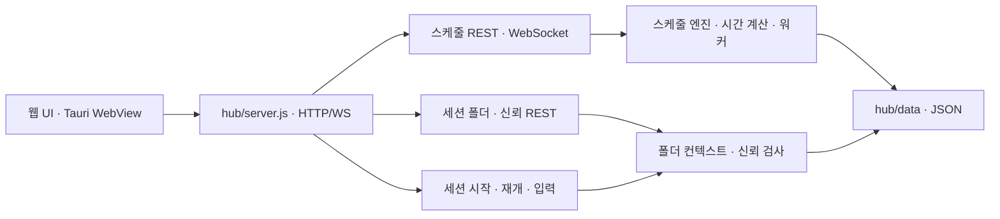

# Agent CLI Hub 코드 구조

- **프로젝트 문서 기준** v1.5.0, 2026-11-26, `dev_side` (`a951fa0` 및 통합 작업 트리)
- **Floorplan 스캐너 표본** 코드·설정 222개 파일, 57,064줄, 엔드포인트 감지 181개, 프런트 호출 매칭 176건. `hub/workspace-floorplan.js`의 정적 감지 결과이며 아래 표의 신규 라우트는 서버 구현에서 직접 대조했습니다.

## 1. 시스템 계층

## 2. 주요 모듈

| 영역 | 파일 | 역할 |
| --- | --- | --- |
| 서버 진입점 | `hub/server.js`, `hub/routes-sessions.js`, `hub/routes-projects.js`, `hub/routes-system.js` | 공통 인증 및 웹소켓 업그레이드, 세션·프로젝트·시스템 라우트 |
| 스케줄 UI | `hub/public/schedules-ui.js`, `hub/public/schedule-form.js`, `hub/public/schedule-trigger.js`, `hub/public/schedule-history.js`, `hub/public/schedule-sync.js` | 목록, 편집, 미리보기, 실행 이력, REST 재조회 |
| 스케줄 전송 | `hub/routes-schedules.js`, `hub/schedule-api-input.js`, `hub/schedule-api-view.js`, `hub/schedule-transport.js` | 입력 검증, 로컬 권한, 원격 응답 필터, 변경 이벤트 |
| 스케줄 실행·저장 | `hub/schedules.js`, `hub/schedule-timing.js`, `hub/schedule-runs.js`, `hub/schedule-worker.js`, `hub/schedule-store.js` | 슬롯 계산, 중복 방지, 동시성·미실행 정책, 워커와 실행 이력 |
| 폴더 UI | `hub/public/workspace-badges.js`, `hub/public/workspace-panel.js`, `hub/public/workspace-folder-edit.js`, `hub/public/workspace-folder-detail.js`, `hub/public/workspace-trust-ui.js` | 세션 배지, 주/참조 폴더 표시·편집, 신뢰 규칙 관리 |
| 폴더 API·저장 | `hub/routes-workspace-folders.js`, `hub/workspace-contexts.js`, `hub/workspace-paths.js`, `hub/workspace-trust.js`, `hub/workspace-sessions.js` | 세션 키 매핑, 폴더 경로 정규화, 저장, 신뢰 범위와 드라이브·경로 상태 검사 |
| 폴더 실행 | `hub/workspace-execution.js`, `hub/workspace-launch.js`, `hub/term-manager.js`, `hub/ptyhost.js` | 신뢰 재검사, PTY 실행, CLI별 인자·환경 변수, 입력 차단 |
| 데스크톱 폴더 선택 | `desktop/src/bridge.rs`, `hub/win-folder-picker.js` | Tauri 브리지와 Windows 로컬 폴더 선택 처리 |
| 기존 기능 | `hub/projects.js`, `hub/calendar.js`, `hub/gpu.js`, `hub/artifacts.js`, `hub/workspace-floorplan.js`, `hub/searchindex.js` | 프로젝트 저장, 캘린더, GPU 대기열, 산출물, 아키텍처 분석, 대화 검색 |

## 3. 스케줄 API

| 메서드 | 경로 | 동작 |
| --- | --- | --- |
| GET / POST | `/api/schedules` | 목록은 `items`, `seq`, `capabilities` 반환. 생성은 일시정지 상태로 저장 |
| GET / PATCH / DELETE | `/api/schedules/:id` | 상세 조회, 편집, 보관 |
| POST | `/api/schedules/preview` | 주기 미리보기 |
| POST | `/api/schedules/:id/pause`, `/api/schedules/:id/resume` | 일시정지 및 대기 실행 취소, 다음 슬롯 예약 |
| POST | `/api/schedules/:id/run` | `revision`과 UUID `requestId`로 즉시 실행. 신규는 201, 같은 요청 재전송은 200 |
| GET | `/api/schedules/:id/runs` | 이력 조회. `limit`과 `before`를 지원하며 다음 페이지에는 `nextCursor`를 전달 |
| WS | `/ws/schedules` | 연결 시 `schedules.ready`. `schedules.changed`의 `seq`, `scheduleIds`, `runIds`를 받아 REST로 갱신 |

기본 리스너가 엔진과 `hub/data/schedules.json`을 소유하고 원격 리스너는 엔진을 공유합니다. 인증된 로컬 접속에서만 쓰기가 가능하며, 원격 조회는 프롬프트·참조 폴더·실행 경로·출력·오류 요약을 생략합니다. 운영 서버는 현재 `capabilities.cli[].available=false`와 `RUNNER_UNAVAILABLE`을 반환합니다. 이 상태에서는 자동 실행이 시작되지 않고 재개·즉시 실행 요청이 `503 SCHEDULE_UNAVAILABLE`을 반환합니다. 정상 실행 경로는 테스트 실행기로 검증합니다.

## 4. 세션 폴더 및 신뢰 API

| 메서드 | 경로 | 동작 |
| --- | --- | --- |
| GET / PUT | `/api/sessions/:sessionKey/folders` | 폴더 상세 조회 및 `primaryCwd`, `referenceDirs`, `revision` 저장. 참조는 최대 16개 |
| GET / POST | `/api/trusted-folders` | 신뢰 레지스트리 조회와 경로 등록 |
| PATCH / DELETE | `/api/trusted-folders/:id` | 하위 폴더 포함 범위 변경과 신뢰 해제 |

세션 및 터미널 목록 응답(`/api/overview`, `/api/recent`)은 `folderContext`에 참조 수, 신뢰 상태, 미적용 여부를 전달합니다. 인증된 원격 접속에서 세션 폴더 조회는 요약만 반환합니다. 레지스트리 접근과 세션 폴더 쓰기는 로컬로 제한됩니다. 컨텍스트와 신뢰 설정은 `hub/data/workspace-contexts.json`에 저장됩니다. 관리 대상 시작·재개 시 주 폴더를 작업 디렉터리로 적용하고 Codex·Claude·AGY에는 `--add-dir`, Cursor·셸에는 `HUB_REFERENCE_DIRS_JSON`으로 참조 목록을 전달합니다. 시작·재개와 허브 입력 경로는 필요한 폴더 신뢰를 다시 확인합니다.

## 5. 동작 검증 위치

- 스케줄 엔진 및 API·WebSocket · `hub/tests/schedules.test.js`, `hub/tests/schedules-api.test.js`
- 폴더 경로·신뢰·실행 어댑터 · `hub/tests/workspace-folders.test.js`, `hub/tests/workspace-launch.test.js`, `hub/tests/workspace-execution.test.js`
- 스케줄·폴더 UI 및 접근성 · `hub/tests/schedules-folders-browser.cjs`, `hub/tests/schedules-browser.cjs`, `hub/tests/workspace-folders-browser.cjs`
