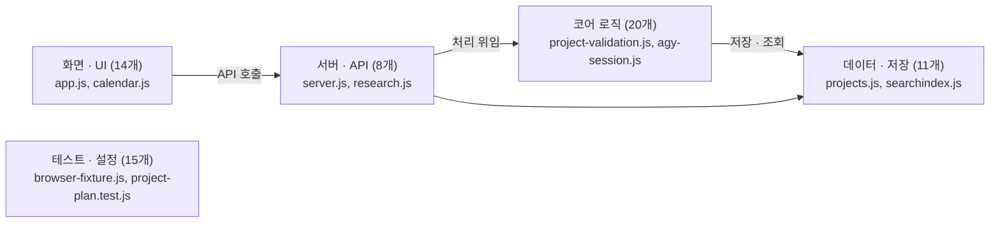

# agent-cli-hub — 코드 아키텍처 & 품질 점검 보고서

- **분석 대상 경로**: `D:\Gitsource\개인\agent-cli-hub`
- **분석 일시**: 2026. 11. 22. 오후 9:50:11
- **코드 규모**: 68개 파일 · 20,377줄 · API 엔드포인트 123개 (프론트 매칭 110건)
- **코드 건강도**: **86점** (위험 0 · 주의 1 · 정보 2)
- **감지된 외부/DB 연동**: AI / LLM, Database, External Auth / Cloud

## 1. 시스템 계층 구조도

## 2. 핵심 허브 모듈 (중요도 순 Top 15)
| 중요도 | 파일 경로 | 계층 | 역할 요약 | 참조 수 | API | 라인 |
| --- | --- | --- | --- | ---: | ---: | ---: |
| 핵심 허브 | `hub/server.js` | 서버 · API | Agent CLI Hub — Claude Code / Codex / Cursor agent sessions in one web page; loc | 0 | 55 | 2661 |
| 핵심 허브 | `hub/research.js` | 서버 · API | Autonomous research projects: API + autopilot watchdog. | 1 | 12 | 422 |
| 핵심 허브 | `hub/calendar.js` | 서버 · API | Calendar: one view over | 1 | 11 | 319 |
| 핵심 허브 | `hub/gpu.js` | 서버 · API | GPU / compute-resource queue (cooperative leases). | 1 | 10 | 781 |
| 핵심 허브 | `ai-usage/server.js` | 서버 · API | API 엔드포인트 9개 처리 (/api/token, /api/meta) | 0 | 9 | 768 |
| 핵심 허브 | `hub/ptyhost.js` | 서버 · API | pty host: owns the dashboard terminals so they survive dashboard-server restarts | 0 | 9 | 79 |
| 핵심 허브 | `hub/workspace-floorplan.js` | 서버 · API | API 엔드포인트 4개 처리 (/api/..., /...) | 3 | 4 | 465 |
| 핵심 허브 | `hub/projects.js` | 데이터 · 저장 | 데이터 저장소 · 스키마 관리 | 6 | 0 | 252 |
| 핵심 허브 | `hub/artifacts.js` | 서버 · API | Per-session outputs ("artifacts"): files a session produced or mentioned (videos | 2 | 4 | 198 |
| 핵심 허브 | `hub/project-validation.js` | 코어 로직 | 핵심 모듈 (project-validation.js) | 5 | 0 | 91 |
| 핵심 허브 | `hub/agy-session.js` | 코어 로직 | 핵심 모듈 (agy-session.js) | 5 | 0 | 39 |
| 주요 | `hub/tests/browser-fixture.js` | 테스트 · 설정 | 자동화 검증 테스트 | 1 | 8 | 97 |
| 핵심 허브 | `hub/public/app.js` | 화면 · UI | Agent CLI Hub — frontend | 1 | 0 | 4131 |
| 핵심 허브 | `hub/searchindex.js` | 데이터 · 저장 | Incremental full-text index over Claude Code transcripts (~/.claude/projects/ | 4 | 0 | 410 |
| 핵심 허브 | `hub/i18n.js` | 코어 로직 | Language support. The hub is written in Korean; English comes from i18n/en.json, | 4 | 0 | 189 |

## 3. 주요 API 엔드포인트
- `ANY /api/artifacts` — `hub/artifacts.js:148`
- `POST /api/artifacts/add` — `hub/artifacts.js:152`
- `POST /api/artifacts/hide` — `hub/artifacts.js:164`
- `ANY /api/artifact-file` — `hub/artifacts.js:173`
- `ANY /api/calendar` — `hub/calendar.js:274`
- `POST /api/calendar/event` — `hub/calendar.js:280`
- `POST /api/calendar/event/delete` — `hub/calendar.js:281`
- `POST /api/calendar/task` — `hub/calendar.js:282`
- `POST /api/calendar/task/add` — `hub/calendar.js:283`
- `ANY /api/calendar/google/auth` — `hub/calendar.js:284`
- `POST /api/calendar/google/sync` — `hub/calendar.js:291`
- `POST /api/calendar/google/disconnect` — `hub/calendar.js:292`
- `POST /api/calendar/ms/connect` — `hub/calendar.js:293`
- `POST /api/calendar/ms/sync` — `hub/calendar.js:301`
- `POST /api/calendar/ms/disconnect` — `hub/calendar.js:302`
- `ANY /api/gpu` — `hub/gpu.js:654`
- `ANY /api/gpu/plan` — `hub/gpu.js:670`
- `POST /api/gpu/est` — `hub/gpu.js:671`
- `POST /api/gpu/toggle` — `hub/gpu.js:687`
- `ANY /api/gpu/remote` — `hub/gpu.js:696`
- `ANY /api/gpu/ticket` — `hub/gpu.js:702`
- `POST /api/gpu/request` — `hub/gpu.js:707`
- `POST /api/gpu/heartbeat` — `hub/gpu.js:740`
- `POST /api/gpu/release` — `hub/gpu.js:753`
- `POST /api/gpu/priority` — `hub/gpu.js:768`
- `ANY /info` — `hub/ptyhost.js:46`
- `ANY /buf` — `hub/ptyhost.js:47`
- `ANY /spawn` — `hub/ptyhost.js:51`
- `ANY /write` — `hub/ptyhost.js:52`
- `ANY /resize` — `hub/ptyhost.js:53`

## 4. 보안 · 구조 점검 결과 (Health Check)
1. **[WARN] 인증/권한 검증 패턴이 보이지 않는 API 라우트 (calendar.js)** (`hub/calendar.js:274`)
   - 설명: 11개 엔드포인트(/api/calendar, /api/calendar/event, /api/calendar/event/delete)가 정의되어 있으나 파일 내부에서 토큰/세션 인증 함수가 감지되지 않았습니다.
   - 권장 조치: hub/calendar.js에 정의된 API 엔드포인트(/api/calendar, /api/calendar/event, /api/calendar/event/delete, /api/calendar/task)의 인증·인가 검사가 누락되지 않았는지 점검하고 필요한 미들웨어를 적용해 주세요.
2. **[INFO] 대형 단일 파일 (2,661줄 · 모듈 분리 권장)** (`hub/server.js:1`)
   - 설명: hub/server.js 파일이 2,661줄로 비대합니다. 기능 단위로 모듈을 분리하면 AI 작업 정확도와 유지보수성이 올라갑니다.
   - 권장 조치: hub/server.js(2661줄)의 책임을 점검해 독립적인 기능/도메인 모듈로 깔끔하게 분리 리팩터링해 주세요. 기존 동작과 테스트는 그대로 유지해야 합니다.
3. **[INFO] 대형 단일 파일 (4,131줄 · 모듈 분리 권장)** (`hub/public/app.js:1`)
   - 설명: hub/public/app.js 파일이 4,131줄로 비대합니다. 기능 단위로 모듈을 분리하면 AI 작업 정확도와 유지보수성이 올라갑니다.
   - 권장 조치: hub/public/app.js(4131줄)의 책임을 점검해 독립적인 기능/도메인 모듈로 깔끔하게 분리 리팩터링해 주세요. 기존 동작과 테스트는 그대로 유지해야 합니다.
