# Agent CLI Hub (에이전트 CLI 관제)

**Windows PC에서 돌아가는 AI 코딩 에이전트를 웹 페이지 하나로 관제합니다.** Claude Code, OpenAI Codex CLI, Cursor 에이전트, 일반 셸까지 모두 한곳에 모입니다.
- 모든 세션 화면을 실시간으로 보고 바로 입력할 수 있습니다.
- 지금까지 나눈 대화 전체를 검색합니다.
- 여러 세션이 GPU를 대기열로 나눠 씁니다.
- **관제 세션**이 PC 상태를 돌봅니다.
- 휴대폰에서도 Tailscale로 접속할 수 있습니다.

[English](README.md) · **한국어**

<sub>설치: `git clone https://github.com/JaekunE2/agent-cli-hub` 후 `start.bat` 실행. 에이전트에게 맡기는 방법은 [설치](#설치)를 보세요.</sub>


> 스크린샷은 가상의 프로젝트와 대화로 만든 데모 환경에서 찍었습니다.

---

## 기능

### 🛰 관제 세션: 허브를 돌보는 에이전트
허브가 켜지면 **관제 세션**이 하나 자동으로 열리고 사이드바 맨 위에 고정됩니다. 기본은 Claude Code이고, Codex로 바꿀 수 있습니다. 관제 세션은 운영 매뉴얼(`operator/CLAUDE.md` · `AGENTS.md`)에 따라 다음 일을 합니다.
- **PC 파악:** GPU, 드라이버·CUDA, 디스크, 네트워크·Tailscale, 프록시, 도구 경로, 계정 상태를 파악합니다. 결과는 **`operator/ENVIRONMENT.md`**에 정리해 두고 계속 고칩니다. 다른 세션들은 이 파일을 읽습니다.
- **질문 응답:** PC나 다른 세션에 대한 질문에 답합니다.
- **정기 점검과 공지:** 기본 3시간마다, 쉬고 있을 때만 점검합니다. 디스크 부족, 예상 시간을 한참 넘긴 GPU 작업, 네트워크 변화, 사용 한도 임박처럼 알릴 일이 생기면 **공지**를 보냅니다.

공지는 게시판(`ccd notices`)에 남고, 실행 중인 모든 Claude·Codex 허브 터미널에 입력됩니다. 작업 중인 에이전트는 지금 하던 턴을 마친 뒤 공지를 읽습니다.

관제 세션은 작업을 종료하거나 계정을 바꾸지 않습니다. 설치나 시스템 설정을 바꿔야 할 때는 먼저 사용자에게 묻습니다.

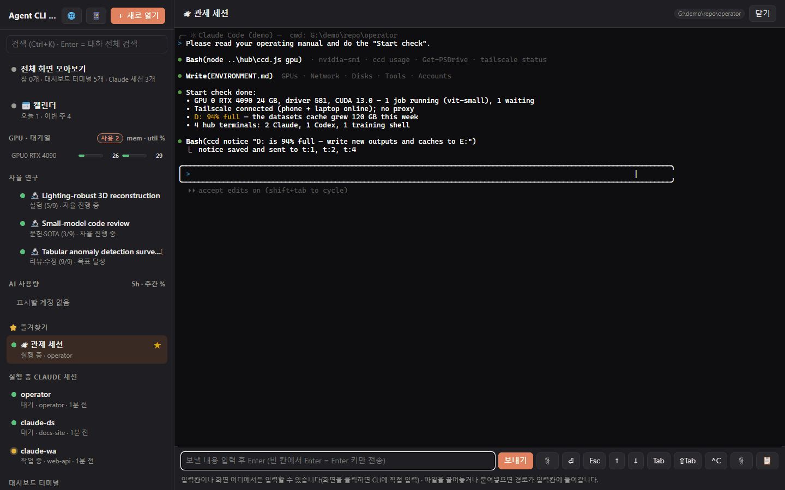

### 🖥 모든 화면 모아보기
허브 터미널을 카드로 모아 실시간으로 보여 줍니다. Python이 있으면 PC의 다른 콘솔 창도 함께 보입니다.
- 카드를 누르면 크게 보면서 입력할 수 있습니다.
  - 허브 터미널은 실제 터미널(xterm.js)로 입력합니다.
  - 다른 창에는 키 입력을 주입합니다.
- 파일을 끌어놓거나 붙여넣으면 그 경로가 입력됩니다.

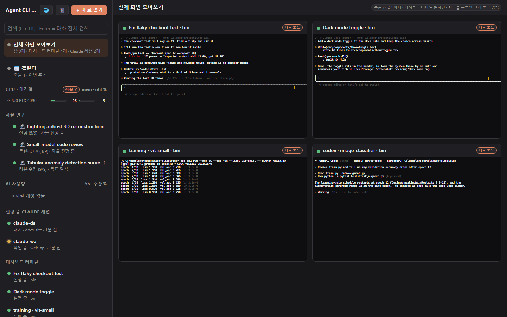

### 🤖 Claude Code · Codex · Cursor · 셸을 나란히
**＋ 새로 열기**로 `claude`, `codex`, `cursor-agent`, PowerShell, cmd를 원하는 폴더에서 띄웁니다.
- Codex 터미널에는 **Codex** 표시가 붙습니다. 화면을 읽어 *작업 중 / 대기* 상태를 실시간으로 보여 주고, 어떤 대화를 이어가는 중인지도 압니다.
- 터미널은 별도 pty 호스트에서 돕니다. 그래서 허브 서버를 다시 시작해도 터미널은 꺼지지 않습니다.

| Claude Code | Codex |
|---|---|
| 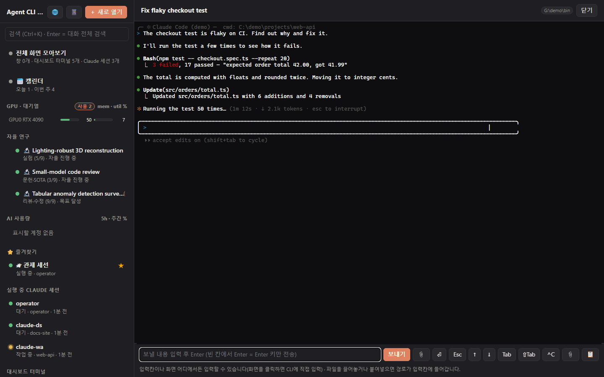 | 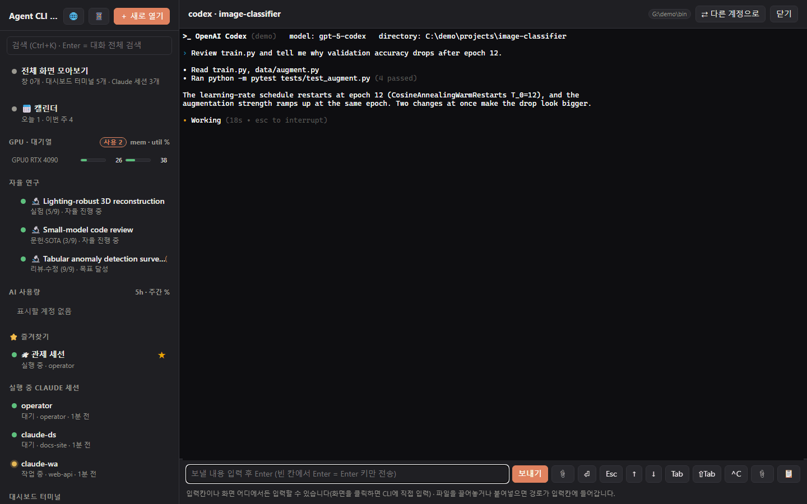 |

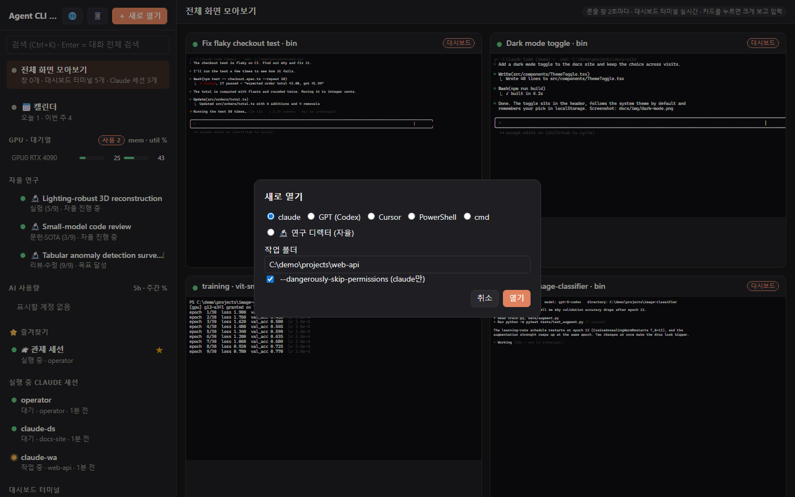

### 🔎 Claude Code와 Codex 대화 전체 검색
`Ctrl+K`를 누르면 다음을 한꺼번에 검색합니다.
- 모든 Claude Code 대화 기록(`~/.claude/projects`)
- 모든 Codex 대화 기록(`~/.codex/sessions`)
- 지금 열려 있는 화면의 글자

검색 결과를 열면 앞뒤 대화를 읽을 수 있고, **대시보드에서 이어하기**로 그 대화를 원래 폴더에서 이어갈 수 있습니다(`claude --resume` / `codex resume`).

| 검색 | Codex 대화 |
|---|---|
| 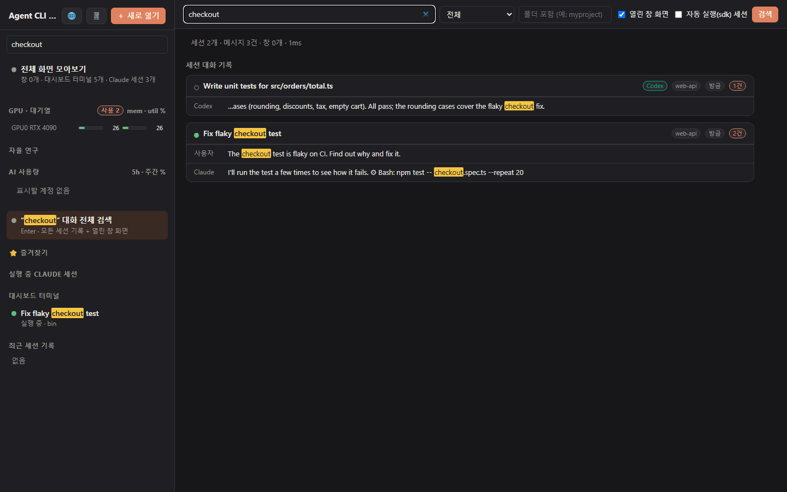 | 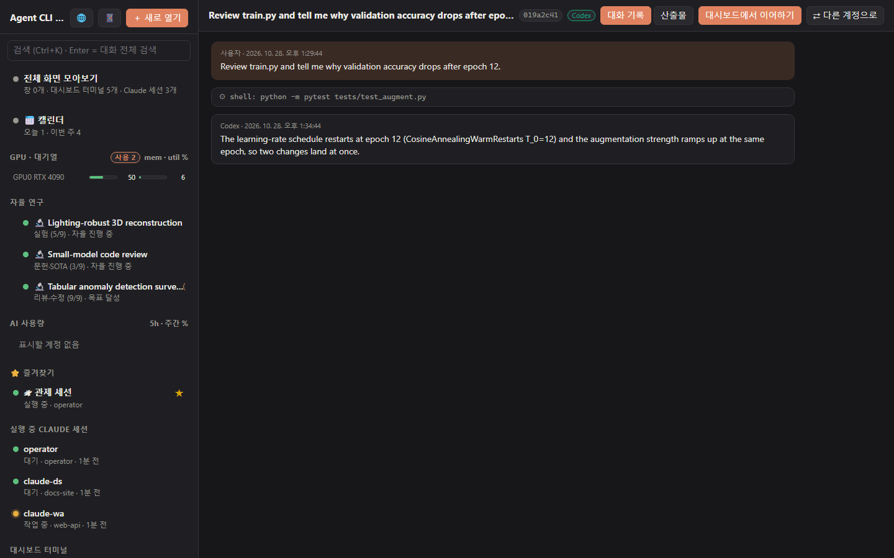 |

### 📂 산출물: 세션이 만든 결과를 모아 미리보기
세션마다 **산출물** 탭이 있습니다.
- 대화에 나온 파일 경로를 자동으로 모아 날짜별로 정리합니다. 영상, PDF, 그림, 슬라이드, 문서, 데이터가 대상입니다.
- 그 자리에서 미리 봅니다.
  - 그림, 영상·음성 플레이어, PDF, Markdown·텍스트·CSV를 바로 엽니다.
  - HTML은 격리된 화면(샌드박스)에서 엽니다.
  - LibreOffice가 있으면 PowerPoint·Word를 PDF로 바꿔 보여 줍니다.
- 다른 파일도 직접 넣을 수 있습니다. **＋ 산출물 지정** 버튼이나 `ccd artifact add <경로> --title "…"`을 쓰세요.
- ↗ 버튼을 누르면 그 파일 경로를 다른 세션에 바로 보냅니다.
- 자율 연구 프로젝트에도 같은 탭이 있습니다.
- 그 세션에 등록된 파일만 열 수 있습니다.

| 산출물 탭 | 미리보기 |
|---|---|
| 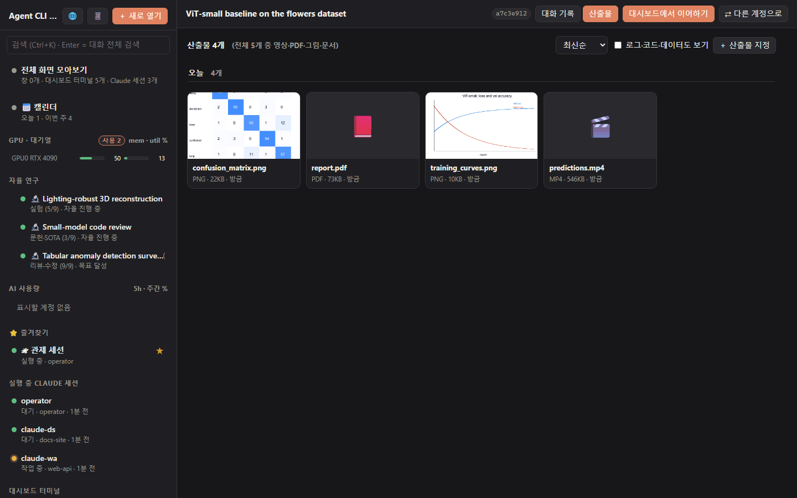 | 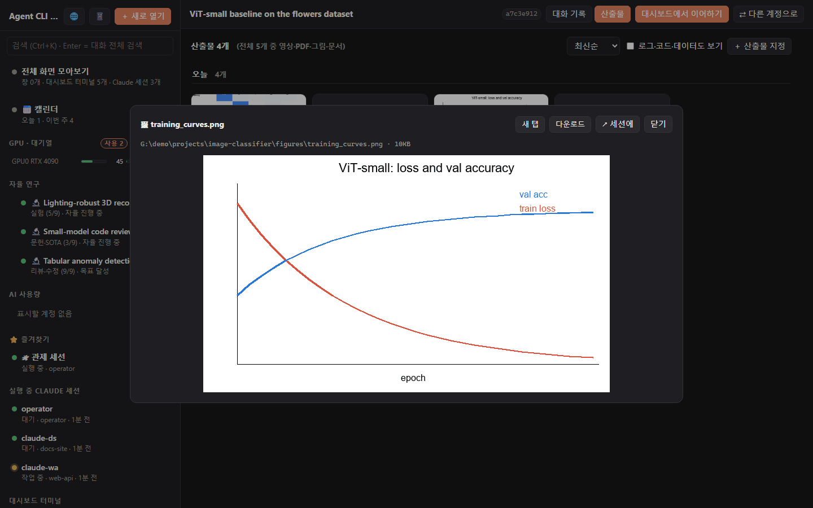 |

### 🎛 모든 세션이 함께 쓰는 GPU 대기열
`ccd gpu run --mem 12G --est 90m -- python train.py`처럼 실행하면 다음 순서로 동작합니다.
1. 차례가 올 때까지 기다립니다.
2. `CUDA_VISIBLE_DEVICES`를 지정해 실행합니다.
3. 작업이 끝나면 GPU를 자동으로 반납합니다.

함께 들어 있는 기능:
- GPU 메모리와 시스템 RAM 예약
- 짧은 작업 끼워넣기(backfill)
- 과열 보호
- GPU별 대기 줄
- 대기열 밖에서 시작한 GPU 작업도 찾아내 "현재 사용자"로 표시

대기열 밖 프로세스는 절대 종료하지 않습니다.

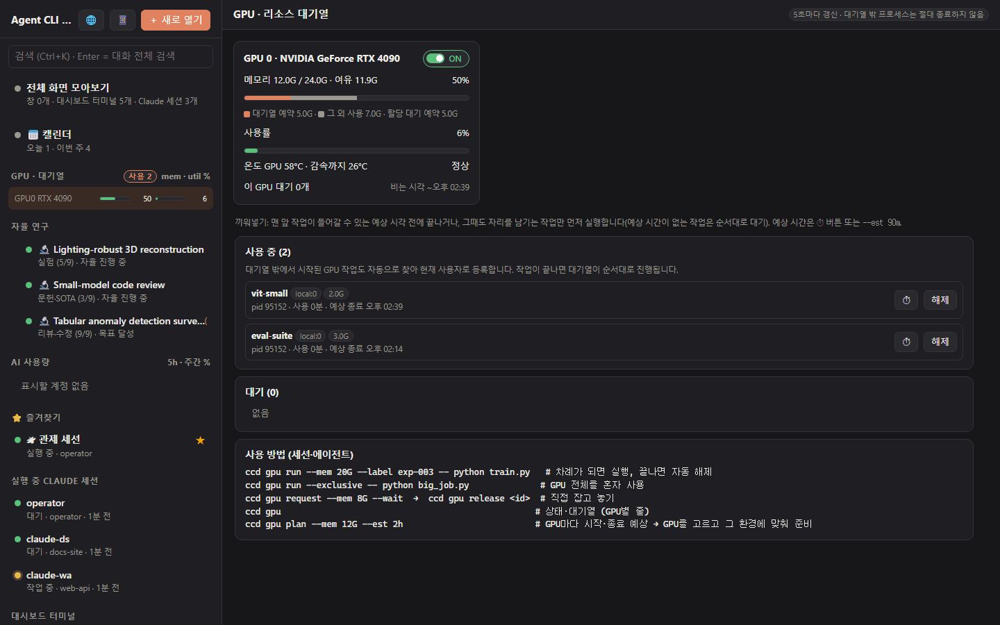

### 🔬 자율 연구 (선택)
연구 방향만 적으면 "디렉터" Claude 세션이 연구 전 과정을 진행합니다.
- 진행 순서: 아이디어 → 학회 선정 → 문헌 조사 → 계획 → 실험 → 분석 → 논문 작성 → 리뷰
  - 문헌 조사에서는 인용이 실제로 있는지 코드로 확인합니다.
  - 실험은 GPU 대기열을 거칩니다.
- 목표에 도달하거나 막혔을 때만 멈춥니다.
- 중간에 메시지를 보내거나 일시정지할 수 있고, 파생 연구나 종합 논문으로 이어갈 수 있습니다.

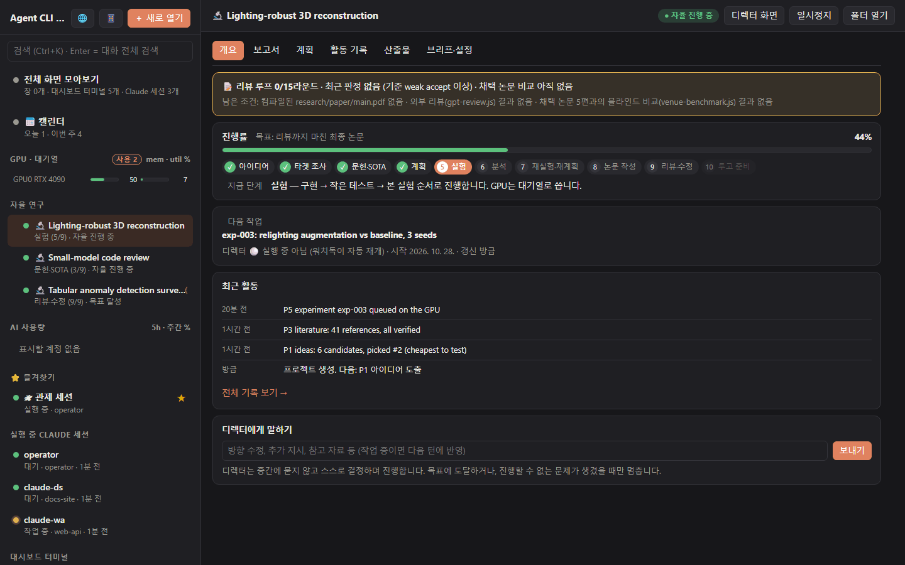

### 📅 캘린더
한곳에서 보는 일정:
- `todo.md`의 마감(`- [ ] 할 일 @due(2026-11-05) #태그`). 에이전트도 같은 파일을 편집할 수 있습니다.
- 허브 자체 일정
- 구글 캘린더 연동(선택)

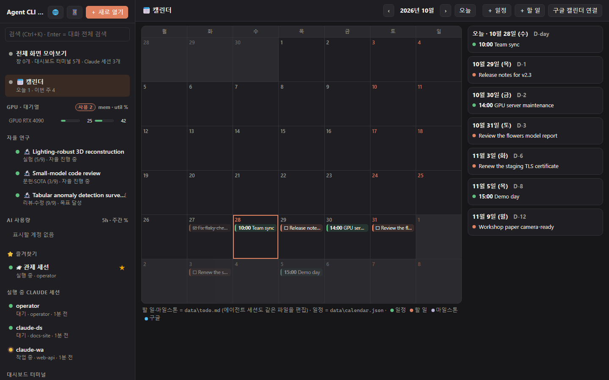

### 📱 휴대폰에서 (Tailscale)
허브는 `127.0.0.1`과 본인 Tailscale 주소에서만 접속을 받습니다. 사내·가정 LAN에는 열리지 않습니다.
- 📱 버튼을 누르면 QR이 나옵니다. 같은 Tailscale 계정으로 로그인한 휴대폰에서 찍으면 됩니다.
- 작은 화면에서는 휴대폰용 배치로 바뀝니다.

| 다른 기기에서 열기 | 휴대폰 화면 |
|---|---|
| 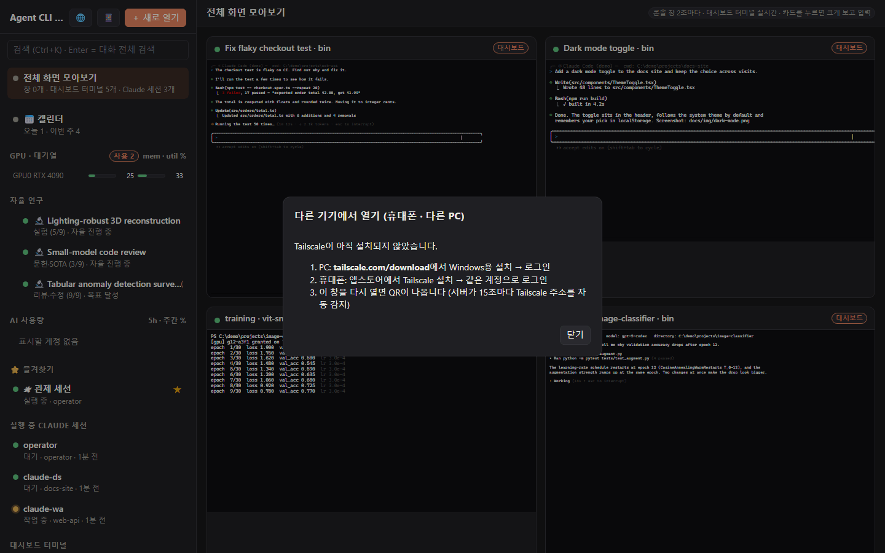 | 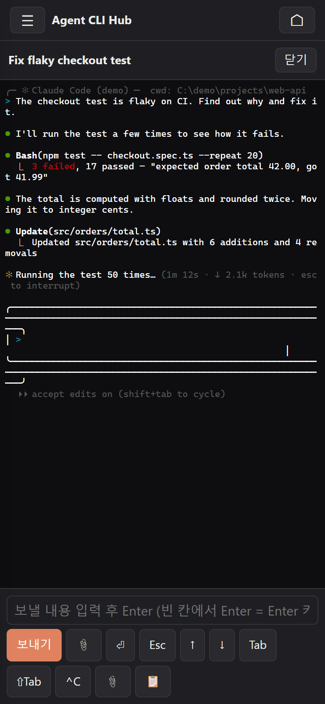 |

### 💬 텔레그램 릴레이: 텔레그램으로 세션과 대화 (관제 없이도 동작)
`telegram-relay/`는 의존성 없는 별도 봇입니다.
- @BotFather로 봇을 만들고 `telegram-relay\setup.bat`을 실행한 뒤, 휴대폰에서 **시작**을 누르면 됩니다. 그다음부터 이 PC의 Claude Code 세션 어디와도 텔레그램으로 대화합니다.
- Claude CLI를 직접 실행하므로(`claude -p --resume`) 관제가 꺼져 있어도 됩니다.

할 수 있는 일:
- 📋 버튼으로 세션 고르기: 최근 / 열림 / 폴더 / 검색 탭, ➕ 새 대화
- 📌 고른 세션은 채팅 맨 위에 고정
- ⏳ 진행 카드에서 지금 하는 단계를 보여 주고, ⏹ 버튼으로 멈춤
- 📱 휴대폰에 맞춘 짧은 답, 긴 답은 한 메시지 안에서 ◀ ▶로 넘김, 답 아래 빠른 답장 버튼
- 📷 보낸 사진·파일은 세션에 경로로 전달
- 📂 세션이 만든 PDF·그림·영상은 텔레그램으로 받음 (그림은 앨범으로)
- 🔔 PC에서 시킨 작업의 답도 받기
- ⚙ 권한·모델을 버튼으로 바꾸기


자세한 내용: [telegram-relay/README.ko.md](telegram-relay/README.ko.md)

### 📊 AI 사용량과 내 계정들
함께 들어 있는 사용량 대시보드(4777 포트)가 다음을 보여 줍니다. 이 PC에 로그인된 계정은 자동으로 찾습니다.
- Claude 5시간·주간 한도
- Codex(ChatGPT) 한도
- Cursor
- OpenAI API 비용
- Gemini 키 상태

**본인의** Codex 로그인은 기기 코드 방식으로 더 추가할 수 있습니다(**＋ Codex 계정 추가**). 세션은 **⇄ 다른 계정으로** 버튼으로 본인의 다른 계정에서 이어갈 수 있습니다. 계정은 버튼을 누를 때만 바뀝니다.

### 🧰 에이전트도 쓰는 CLI: `ccd`
모든 기능을 명령으로 쓸 수 있어서, 에이전트끼리 서로 일을 나눠 맡길 수 있습니다.
```
ccd ls                                   # 세션·창·터미널 목록
ccd new codex --cwd C:\work\api          # 터미널 열기 (claude | codex | cursor | powershell | cmd)
ccd send t:4 "total.ts 테스트 작성해줘"     # 프롬프트 입력
ccd wait t:4                             # 그 Claude/Codex 턴이 끝날 때까지 기다렸다가 화면 출력
ccd search "flaky checkout" --agent codex
ccd log 019a2c41 --at 12                 # 검색 결과 주변 대화 보기
ccd gpu run --mem 8G --est 30m -- python eval.py
ccd notice "GPU 0은 18시까지 장기 학습용"     # 모든 세션에 공지
ccd gpt "이 diff 리뷰해줘" --file d.patch    # Codex CLI로 받는 2차 의견 (읽기 전용)
```
`start.bat`은 다음 두 가지를 설치합니다. 그래서 Claude Code와 Codex 세션 모두 허브, GPU 대기열, 공지 쓰는 법을 압니다.
- Claude Code용 **`agent-cli-hub` 스킬**
- 짧은 사용 안내: `~/.claude/CLAUDE.md`와 **`~/.codex/AGENTS.md`**에 추가

### 🌐 한국어 / English
🌐 버튼이나 `hub/config.json`의 `"lang"`으로 바꿉니다. 서버와 CLI 메시지도 같은 언어로 나옵니다.

---

## 필요한 것
- Windows 10 / 11
- [Node.js](https://nodejs.org) 20 이상 (`start.bat`이 winget으로 설치해 줄 수 있습니다)
- 에이전트 CLI 하나 이상: [Claude Code](https://docs.claude.com/claude-code), [Codex CLI](https://github.com/openai/codex)(`npm i -g @openai/codex`), Cursor `cursor-agent`(선택)
- 선택 사항:
  - Python 3: 허브가 열지 않은 콘솔 창도 보고 입력하려면 필요합니다.
  - [Tailscale](https://tailscale.com): 휴대폰이나 다른 PC에서 접속하려면 필요합니다.
  - NVIDIA GPU: GPU 대기열을 쓰려면 필요합니다.

## 설치
**1. 받아서 실행.**
```
git clone https://github.com/JaekunE2/agent-cli-hub
cd agent-cli-hub
start.bat
```
- git이 없으면 [ZIP 받기](https://github.com/JaekunE2/agent-cli-hub/archive/refs/heads/main.zip)로 받아 원하는 곳에 풀고 `start.bat`을 더블클릭하세요.
- [Node.js](https://nodejs.org) 20 이상이 필요합니다. 없으면 `start.bat`이 `winget`으로 LTS 버전을 설치할지 묻습니다.
- 처음 실행할 때 `npm install`을 합니다.
- 업데이트는 `git pull`로 합니다. ZIP을 새로 받아 덮어써도 됩니다. 설정과 데이터는 받은 파일에 들어 있지 않아 그대로 남습니다.

**2. 에이전트에게 맡기기.** Claude Code나 Codex에 아래 문장을 붙여 넣으세요.
> https://github.com/JaekunE2/agent-cli-hub/blob/main/INSTALL_FOR_AGENTS.md 를 따라 이 PC에 Agent CLI Hub를 설치해줘. "(ask)" 표시된 단계는 나한테 먼저 물어봐.

**`start.bat`이 하는 일:**
1. `agent-cli-hub` 스킬과 사용 안내를 설치합니다.
2. 허브(7777)와 사용량 대시보드(4777)를 콘솔 창 없이 켭니다.
3. 브라우저를 엽니다.

주소에는 접속 토큰이 들어 있습니다. 같은 주소가 `hub\url.txt`에도 저장됩니다. 이 PC에서는 토큰 없이 `http://127.0.0.1:7777`로 열어도 됩니다.

- 로그인할 때 자동 시작: `powershell -ExecutionPolicy Bypass -File install-autostart.ps1` (해제: `uninstall-autostart.ps1`)
- 종료: `stop.bat` (허브 터미널도 함께 닫힙니다)
- 제거: `uninstall.ps1`로 스킬, 안내, 자동 시작을 지운 뒤 폴더를 삭제합니다.

## 휴대폰·다른 PC에서 접속
1. PC에 Tailscale을 설치하고 로그인합니다.
2. 휴대폰(또는 다른 PC)에도 같은 계정으로 Tailscale에 로그인합니다.
3. 허브에서 📱 버튼을 누르고 QR을 찍습니다. 한 번 열면 그다음부터는 주소만으로 열립니다.

## 설정: `hub\config.json` (선택, 예시는 `hub\config.example.json`)
| 키 | 의미 |
|---|---|
| `lang` | `"ko"` 또는 `"en"` (기본: Windows 표시 언어) |
| `operator` | `{ "enabled": false }`: 관제 세션 끄기 · `"agent": "codex"`: Codex로 실행 · `"checkEveryMin": 0`: 정기 점검 끄기 |
| `remote` | `"off"`: Tailscale 주소로 접속 받지 않기 |
| `consoles` | `false`: 다른 콘솔 창 숨기기 (이때는 Python 필요 없음) |
| `codex`, `cursorAgent`, `python` | PATH에 없을 때 지정하는 실행 파일 경로 |
| `calendar` | `todo`, `events`, `googleAccount`, `timeZone` |
| `usageUrl`, `usageDir` | 사용량 대시보드 주소와 계정 파일 위치 |

## 보안
- 토큰이 있으면 누구든 이 PC의 터미널을 조작할 수 있습니다. `hub\.token`, `hub\url.txt`, QR을 남에게 보여 주지 마세요.
- 허브는 `127.0.0.1`과 Tailscale(100.64.0.0/10) 주소에서만 응답합니다. 다른 사이트에서 오는 요청은 거절합니다(DNS rebinding 방지).
- 사용량 대시보드에 넣은 토큰과 키는 이 PC의 `ai-usage\accounts.json`에만 저장됩니다. 이 파일은 git에 올라가지 않습니다.
- 본인 계정만 등록하세요. 남의 계정을 쓰는 것은 각 서비스 약관 위반입니다. 허브는 사용 한도를 피하려고 계정을 자동으로 바꾸지 않습니다.

## 폴더 구성
```
hub/               서버, CLI(ccd.js), 웹 화면, GPU 대기열, 검색 색인, 다국어
ai-usage/          AI 사용량 대시보드 (4777)
operator/          관제 세션 운영 매뉴얼(CLAUDE.md / AGENTS.md)과 ENVIRONMENT.md
research-harness/  자율 연구: 훅, 프로젝트 템플릿, 도구
skills/            agent-cli-hub 스킬 + paper-review/claims/numbers/code 스킬
guidance/          start.bat이 ~/.claude/CLAUDE.md와 ~/.codex/AGENTS.md에 넣는 안내
telegram-relay/    Claude Code 세션용 텔레그램 봇 (독립 실행, 의존성 없음)
```

## 라이선스
MIT
