# Agent CLI Hub (에이전트 CLI 관제)

**Windows PC에서 실행되는 모든 AI 코딩 에이전트를 웹 페이지 하나로 관제합니다.** Antigravity CLI(AGY), Claude Code, OpenAI Codex CLI, Cursor 에이전트, PowerShell/cmd 셸까지 한곳에 모아 실시간 화면 제어, 프로젝트 단위 AI 작업 설계, 코드 아키텍처 분석, GPU 대기열 공유, Tailscale 모바일 접속을 제공합니다.

[English](README.md) · **한국어**

<sub>설치: `git clone https://github.com/JaekunE2/agent-cli-hub` 후 `start.bat` 실행 (직접 실행은 [설치 및 실행](#설치-및-실행) 참고)</sub>

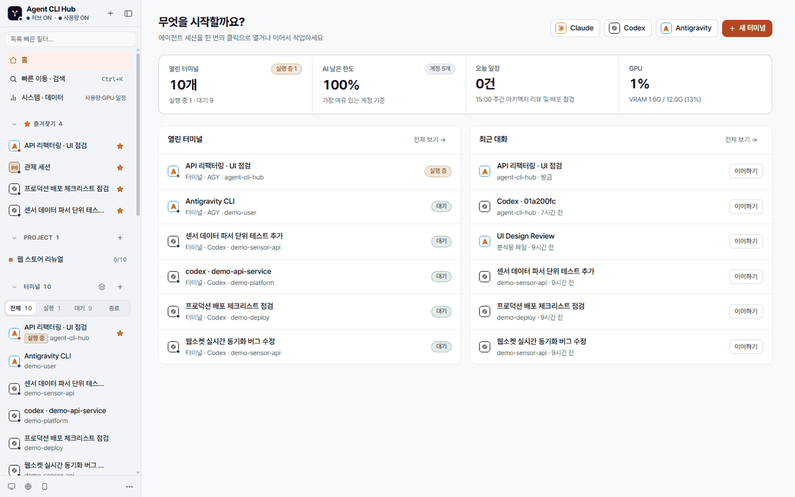

> 안내: 아래 기존 갤러리 스크린샷은 초기 데모 환경 캡처이며, 현재 브랜치(`dev_side`)에는 **Crisp Minimal 개편 UI(라이트/다크 3단 표면 분리, 통합 Hub Core 아이콘, 헤어라인 지표 바)** 와 **Project · 코드 구조(Floorplan) · AGY · 스마트 붙여넣기** 기능이 반영되어 있습니다.

---

## 디자인 시스템 & 핵심 개편 사항 (`dev_side`)

- **Crisp Minimal UI (라이트 · 다크 모드)**: `Astryx` 컴포넌트 규격, `impeccable` 웹 품질/WCAG AA 대비 검사, Linear/SHIUI 스타일의 헤어라인 중심 레이아웃을 적용했습니다.
  - 사이드바(`--side-bg`) · 본문 캔버스(`--bg`) · 카드(`--panel`)의 3단 명도 분리와 1px 헤어라인 보더를 사용하고, 그림자는 팝오버·드로어·모달 등 실제 떠 있는 레이어에만 제한했습니다.
  - 홈과 코드 구조 상단의 4개 지표를 **하나의 연결형 4열 헤어라인 지표 바**로 묶고, 좌측 사이드바 중복 배지를 걷어내 `실행 중` 상태와 작업 폴더가 즉시 눈에 들어옵니다.
  - `24×24px` 이상 클릭 타겟 및 모바일(`390px` 등) 입력창 높이 보정으로 데스크톱·모바일 모두 쾌적하게 조작할 수 있습니다.
- **통합 `Hub Core` 아이콘 & 실시간 상태 팝오버**: 웹 좌상단 브랜드 마크, 브라우저 탭 실시간 파비콘(`icon.svg`), Windows 트레이 아이콘(`tray.ps1`)을 동일한 **Hub Core** 심볼로 통일했습니다. 좌상단 `Agent CLI Hub` 버튼을 누르면 **허브(:7777) · PTY 호스트 · 사용량 서버(:4777) · AGY 쿼터** 상태를 즉시 확인하고 클릭 한 번으로 사용량 서버를 켤 수 있습니다.
- **마지막 탭 기억 & 자동 UI 갱신**: 터미널/최근 대화의 `화면`, `화면 + 대화`, `대화 기록`, `산출물`, `코드 구조` 선택을 기억하며, 서버 업데이트 시 활성 터미널 입력을 끊지 않는 범위에서 `SERVER_BUILD_ID` 기반으로 새 UI를 자동 반영합니다.

---

## 주요 기능

### 🗂 Project 작업 설계 · 칸반 · 작업 흐름(DAG) · 서브 개발 · 토큰 합산

- **AI 기반 작업 분해 (`작업 설계`)**: 사이드바 **Project → ＋ 새 Project**에서 작업 폴더(원격/로컬 폴더 탐색기 또는 Windows 탐색기 선택), 목표·완료 기준, 기본 CLI 및 계정, **CLI별 모델·추론 강도(reasoning effort)**를 설정하면 `설계·기획 / 개발·구현 / 테스트·검증 / 배포·문서` 작업 카드를 자동 생성합니다. (AGY · Claude Code · Codex 지원, YOLO 자동 승인 기본값 지원)
- **칸반 보드 & 인터랙티브 작업 흐름 (`칸반 보드` / `작업 흐름`)**:
  - 카드를 `대기 → 진행 → 검토 → 완료`로 드래그 이동하거나 단계 배지를 전환할 수 있습니다.
  - **작업 흐름(DAG)**은 자동 계층 정렬(Sugiyama)과 **간선 단순화** 토글, 자유 드래그 배치(`localStorage` 저장), 확대/축소/화면 맞춤, 마우스 오버 시 선후행 체인 강조를 지원합니다.
- **하위 서브태스크 & 태스크 내장 서브 개발 채팅 (`서브 개발`)**: 상위 작업을 더 잘게 쪼개고, 우측 상세 드로어 안의 내장 채팅창에서 해당 태스크 맥락으로 바로 추가 개발을 지시할 수 있습니다.
- **멀티 CLI 누적 토큰 집계 (`hub/data/projects.json`)**: 태스크 실행 중 CLI를 바꿔도 토큰 사용량이 누적 보관되며, 모든 하위 서브태스크의 토큰이 최상위 부모 태스크 배지와 Project 토큰 상세 드로어로 자동 합산됩니다.
- **안전한 Project 삭제**: Project 삭제 시 연결된 CLI 터미널을 종료하고 확인된 원본 대화만 정리하며, 작업 폴더의 소스 파일은 그대로 유지됩니다.

### 🗺 코드 구조 (Floorplan) — 인터랙티브 계층 맵 & 아키텍처 보고서

**Project · 터미널 · 외부 콘솔 · 최근 대화** 어디서나 **`코드 구조`** 탭으로 진입할 수 있으며, 상단 **폴더 선택** 버튼으로 임의 폴더의 구조도 즉시 분석할 수 있습니다.

- **핵심 요약 · 모듈 목록**: `.gitignore`를 준수하는 무의존성 정적 스캐너([`hub/workspace-floorplan.js`](hub/workspace-floorplan.js))가 파일당 512KB까지 분석해 참조 수·API 엔드포인트·호출 관계를 기준으로 **최핵심 허브 순위**를 산정하고, 파일 클릭 시 영향 범위(Blast Radius) 상세 드로어를 엽니다.
- **시스템 아키텍처 계층 맵 (`시스템 계층도`)**: 수십 개 파일의 선이 엉키지 않도록 계층별 핵심 허브만 선별해 `화면·UI → 서버·API → 코어 로직 → 데이터·저장`으로 배치합니다. 모듈을 클릭하거나 마우스를 올리면 **들어오는 호출(초록 점선)**과 **나가는 의존성(주황 실선)**만 선명하게 집중 표시하며, 검색·드래그 팬·줌/화면 맞춤을 지원합니다.
- **보안 · 구조 점검**: 시크릿/토큰 노출 의심, `.env`의 `.gitignore` 누락, 인증 가드 없는 API 라우트, 비대 모듈 등을 자동 점수화하고 클릭 한 번으로 Project 수정 작업 추가 또는 터미널 수정 지시를 보냅니다.
- **보고서 보기 & 산출물(`FLOORPLAN.md`) 저장**: 상단 **`보고서 보기`**에서 Mermaid 계층 다이어그램과 핵심 허브 Top 15 표가 포함된 마크다운 전문을 확인하고, **`산출물 저장`**으로 작업 폴더에 `FLOORPLAN.md`를 생성함과 동시에 해당 세션의 **산출물** 탭에 자동 등록할 수 있습니다. 코드가 아직 없는 빈 프로젝트는 태스크 기반 **설계 청사진(Blueprint)** 모드로 전환됩니다.

### 🤖 Antigravity CLI (AGY) · Claude Code · Codex · Cursor · 셸 통합

- **AGY 대화 기록 & 한도 연동**: `~/.gemini/antigravity/brain`, `antigravity-cli/brain`, `antigravity-ide/brain`의 대화 기록을 읽고 대시보드에서 바로 이어하기(`화면 + 대화` 실시간 갱신)를 지원합니다. CLI별/등급별 5시간·주간 한도도 함께 추적합니다.
- **터미널 스마트 붙여넣기 (`Ctrl+V` / `Ctrl+Shift+V`)**: Windows 브라우저에서 터미널 화면에 포커스를 둔 채 **`Ctrl+V`로 텍스트를 바로 붙여넣을 수 있으며**, 클립보드에 **이미지**가 있을 때는 로컬 터미널에 raw `^V`(`0x16`)를 그대로 전달해 `agy`/`claude`/`codex`의 네이티브 TUI 이미지 붙여넣기가 막힘없이 동작합니다. 파일 경로 업로드 붙여넣기는 `Ctrl+Shift+V`, 드래그&드롭, 원격 접속 시 자동 작동합니다.
- **별도 PTY 호스트 & 중복 방지**: 모든 터미널은 `ptyhost.js`에서 실행되어 허브 서버 재시작 시에도 유지되며, 재개·계정 전환·복구 시 동일 세션 터미널이 중복 열리지 않도록 관리합니다.

### 🛰 관제 세션: 허브를 돌보는 에이전트
허브가 켜지면 **관제 세션**이 하나 자동으로 열려 사이드바 맨 위에 고정됩니다(기본 Claude Code, Codex 변경 가능). `operator/CLAUDE.md` · `AGENTS.md`에 따라 GPU·드라이버·디스크·네트워크·계정 상태를 **`operator/ENVIRONMENT.md`**에 기록하고, Idle 시간대에 정기 점검 공지(`ccd notices`)를 보냅니다. 사용자 작업을 임의로 종료하거나 계정을 자동 전환하지 않습니다.

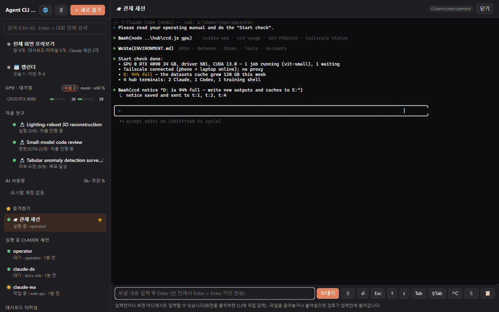

### 🖥 모든 화면 모아보기 & 분할 터미널
허브 터미널과 외부 콘솔 창(Python 사용 시)을 실시간 카드로 모아보고, 클릭 시 `화면`, `화면 + 대화`(크기 조절 가능 분할 뷰), `대화 기록`(하단 메신저형 입력창), `산출물`, `코드 구조` 탭을 오가며 작업합니다.

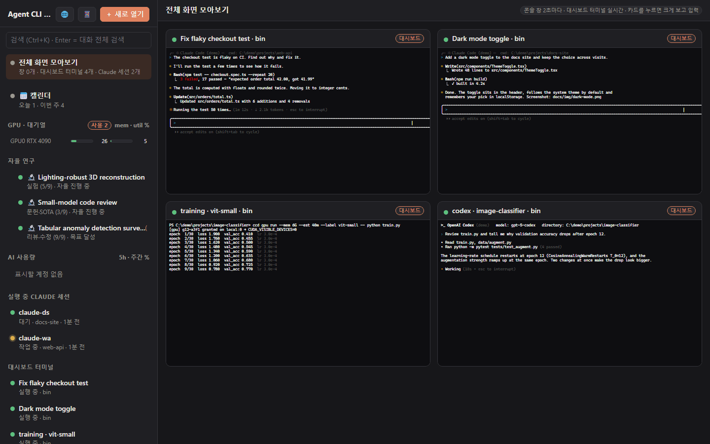

| Claude Code | Codex |
|---|---|
| 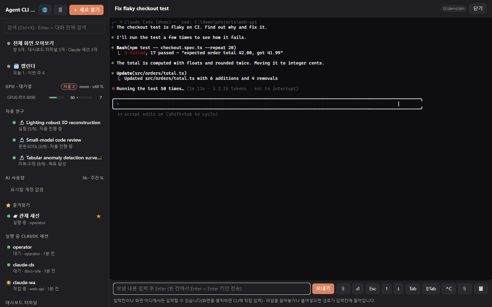 | 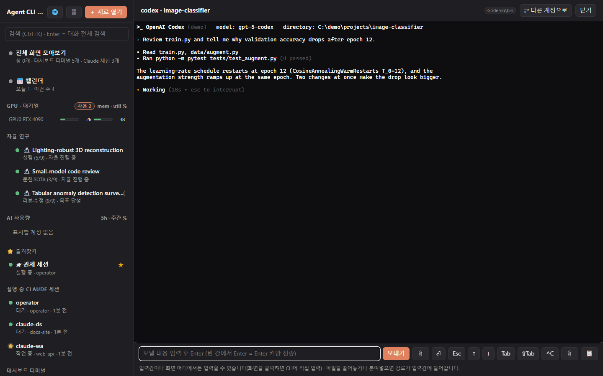 |

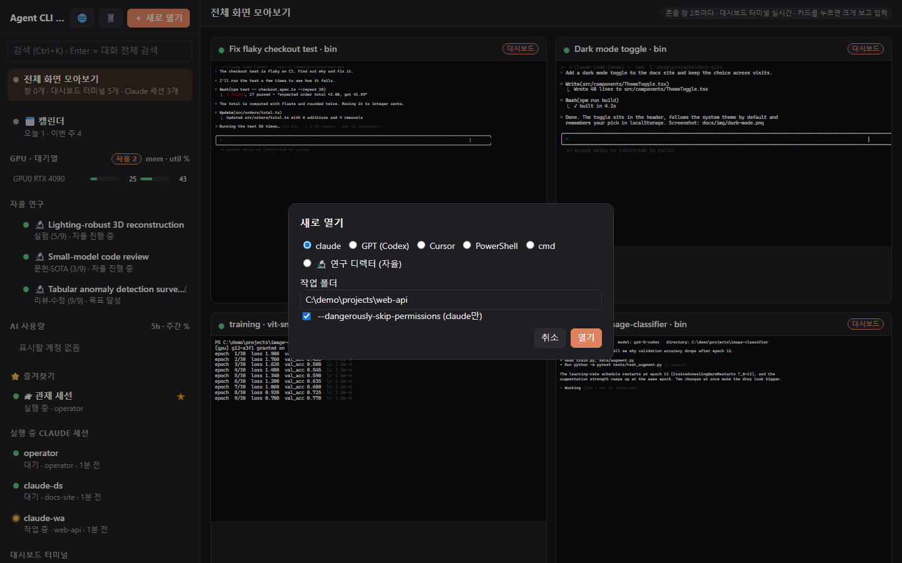

### 🔎 AGY · Claude Code · Codex 대화 전체 검색 (`Ctrl+K`)
`Ctrl+K`로 **AGY**, **Claude Code**(`~/.claude/projects`), **Codex**(`~/.codex/sessions`) 대화 기록과 현재 열린 화면 텍스트를 한꺼번에 검색하고 원래 폴더에서 바로 대화를 이어갈 수 있습니다.

| 검색 | Codex 대화 |
|---|---|
| 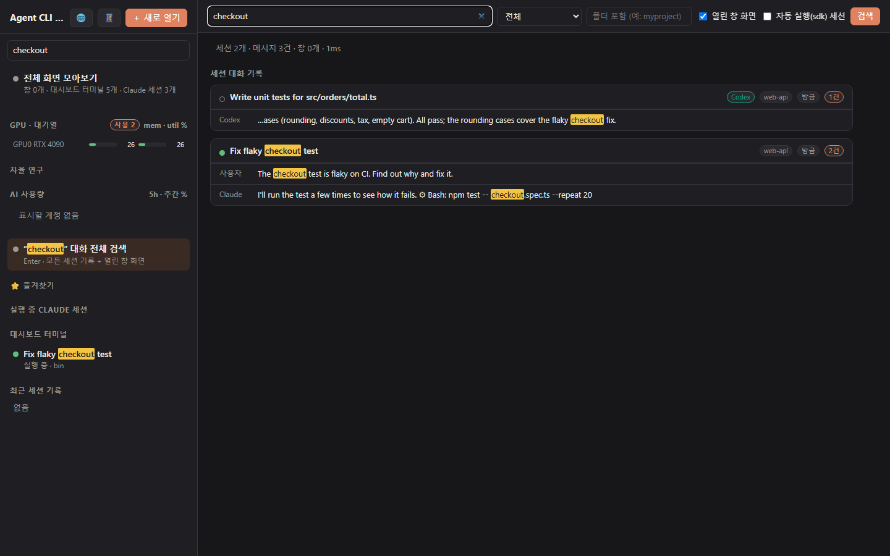 | 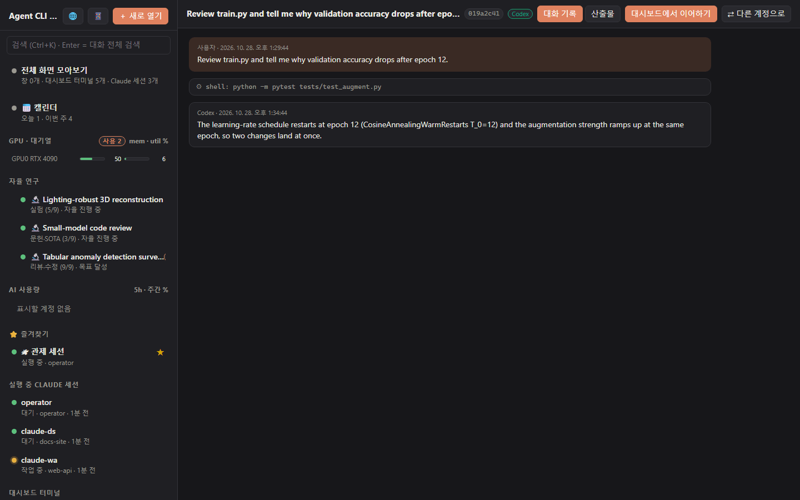 |

### 📂 산출물: 세션 결과 자동 수집 및 미리보기
세션 대화에 등장한 영상·PDF·이미지·Markdown·CSV·샌드박스 HTML·LibreOffice 변환 문서를 날짜별로 모아 미리 봅니다. **＋ 산출물 지정** (`ccd artifact add`), `코드 구조` 보고서(`FLOORPLAN.md`) 자동 등록, ↗ 경로 멘션 전송을 지원합니다.

| 산출물 탭 | 미리보기 |
|---|---|
| 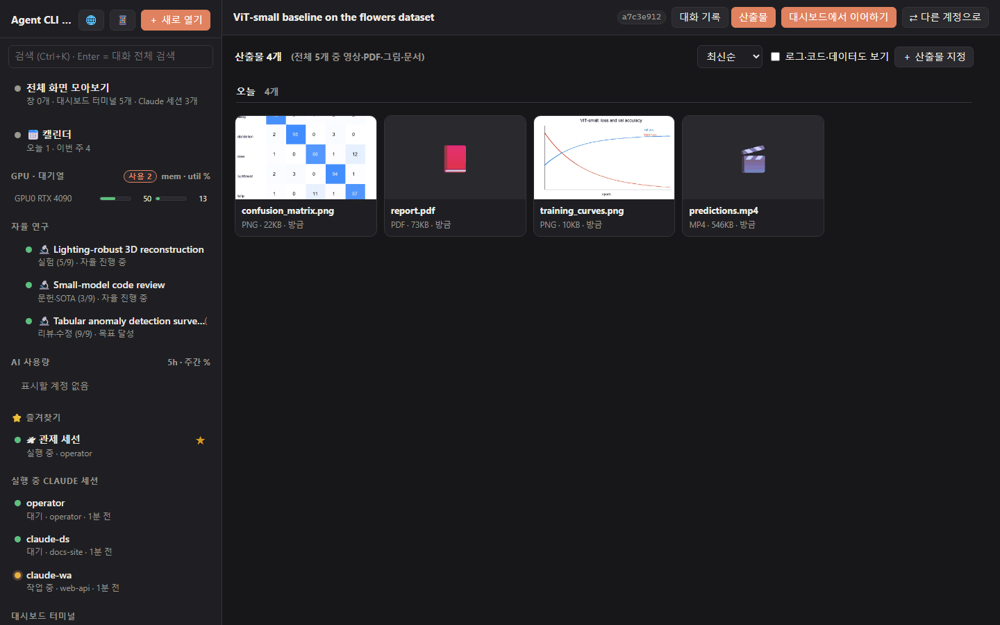 | 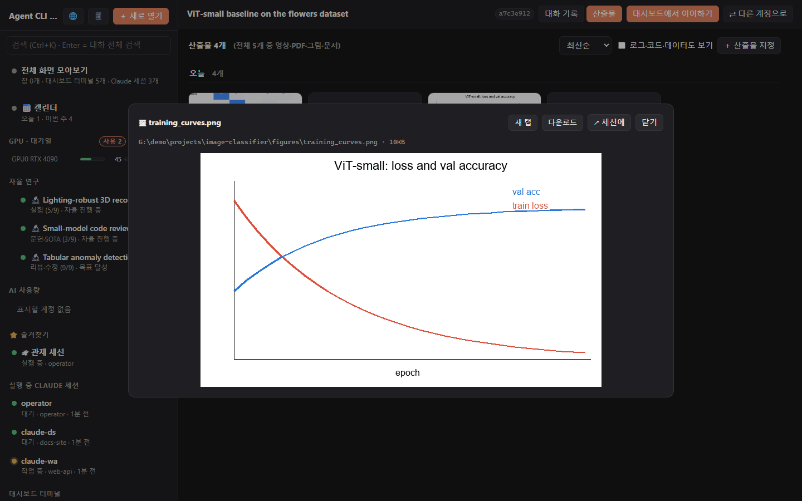 |

### 🎛 GPU 대기열 · 🔬 자율 연구 · 📅 캘린더 · 📊 AI 사용량
- **GPU 대기열**: `ccd gpu run --mem 12G --est 90m -- python train.py`로 순서 대기, `CUDA_VISIBLE_DEVICES` 할당, 짧은 작업 끼워넣기(backfill), 과열 보호, 외부 GPU 프로세스 감지(비강제 종료)를 제공합니다.
- **자율 연구 (선택)**: `research-harness/` 기반으로 아이디어 → 문헌 검증 → GPU 실험 → 논문 작성·리뷰 루프를 실행합니다.
- **캘린더**: `todo.md` 마감(`@due(...) #태그`), 허브 일정, Google 캘린더 · Teams 일정을 월간 그리드와 예정 목록으로 관리합니다.
- **AI 사용량 (4777)**: Claude 5시간·주간 한도, Codex(ChatGPT) 한도, **Antigravity 등급별 쿼터**, Cursor, OpenAI API 비용, Gemini 키를 표시하며 **⇄ 다른 계정으로** 수동 전환을 지원합니다.

| GPU 대기열 | 캘린더 | 자율 연구 |
|---|---|---|
| 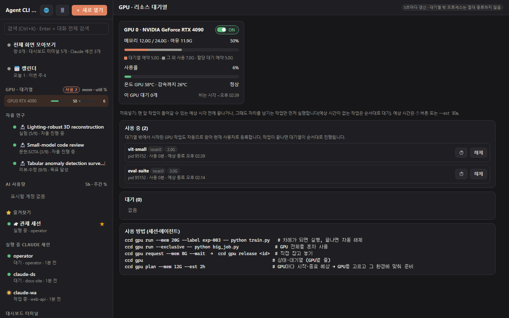 | 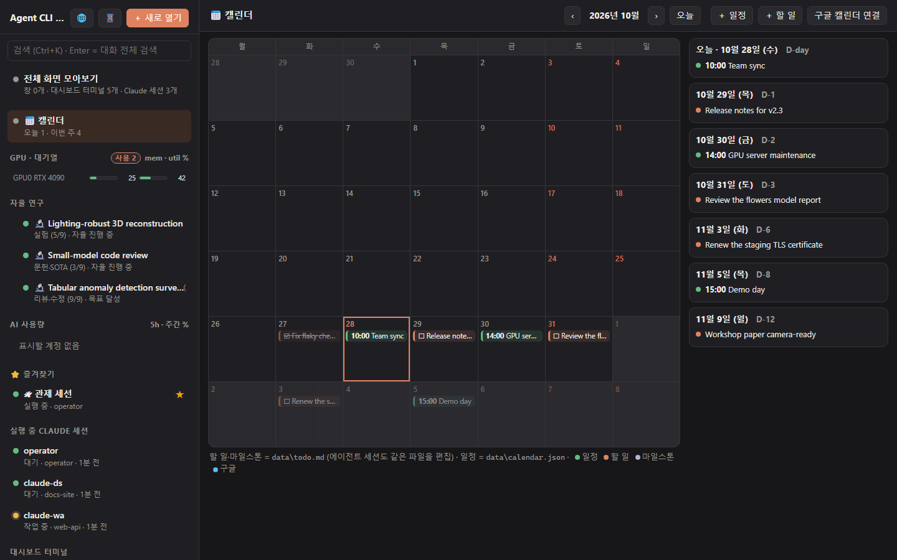 | 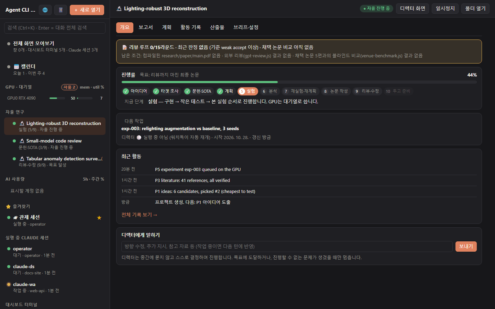 |

### 📱 휴대폰 접속(Tailscale) · 💬 텔레그램 릴레이 · 🧰 `ccd` CLI
허브는 `127.0.0.1`과 Tailscale IP(`100.64.0.0/10`)에서만 응답합니다. 📱 QR 코드로 휴대폰에서 바로 접속할 수 있으며, 텔레그램 연동은 **[JaekunE2/claude-telegram-relay](https://github.com/JaekunE2/claude-telegram-relay)**를 참고하세요.

```bash
ccd ls                                   # 세션·창·터미널 목록
ccd new codex --cwd C:\work\api          # 터미널 열기 (claude | codex | agy | cursor | powershell | cmd)
ccd send t:4 "total.ts 테스트 작성해줘"     # 프롬프트 입력
ccd wait t:4                             # 턴 종료 대기 후 화면 출력
ccd search "flaky checkout" --agent codex
ccd log 019a2c41 --at 12                 # 검색 결과 주변 대화 보기
ccd gpu run --mem 8G --est 30m -- python eval.py
ccd notice "GPU 0은 18시까지 장기 학습용"     # 모든 세션에 공지
ccd gpt "이 diff 리뷰해줘" --file d.patch    # Codex CLI 2차 의견
ccd restart                              # 허브 서버 안전 재시작 (터미널 유지)
```

| 다른 기기에서 열기 | 휴대폰 화면 |
|---|---|
| 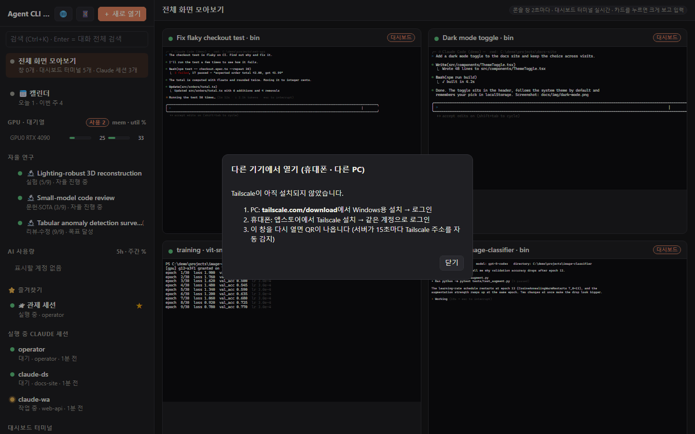 | 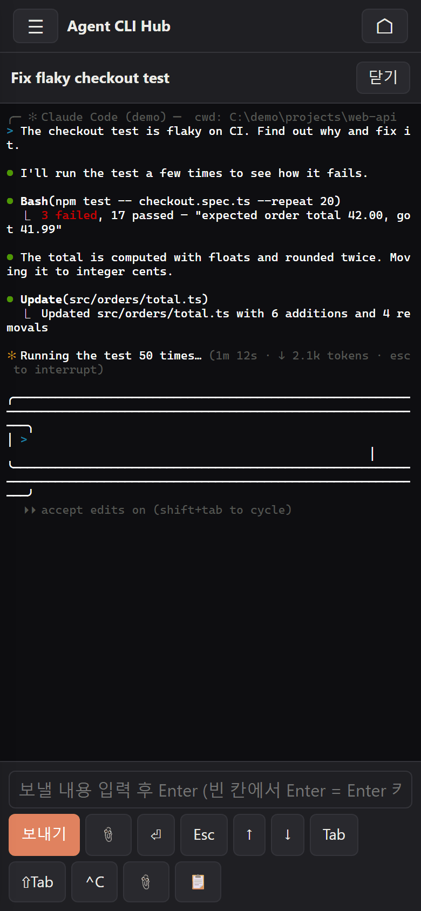 |

### 🌐 한국어 / English
좌하단 🌐 버튼이나 `hub/config.json`의 `"lang"` 설정으로 즉시 전환합니다.

---

## 필요한 것
- Windows 10 / 11
- [Node.js](https://nodejs.org) 20 이상
- 에이전트 CLI 하나 이상: [Claude Code](https://docs.claude.com/claude-code), [Codex CLI](https://github.com/openai/codex), Antigravity CLI(`agy`), Cursor `cursor-agent`
- 선택 사항: Python 3(외부 콘솔 창 제어), [Tailscale](https://tailscale.com)(휴대폰/원격 접속), NVIDIA GPU(`nvidia-smi`)

## 설치 및 실행

**방법 1: Windows 원클릭 실행**
```powershell
git clone https://github.com/JaekunE2/agent-cli-hub
cd agent-cli-hub
start.bat
```

**방법 2: Node.js 직접 설치·실행 및 테스트**
```powershell
cd hub
npm install
npm start
```
자동화 단위 테스트 실행:
```powershell
cd hub
npm test
```

`start.bat`은 스킬/안내 블록 설치 후 허브(`7777`), 사용량 서버(`4777`), Windows 시스템 트레이(`tray.ps1`)를 콘솔 창 없이 실행하고 브라우저를 엽니다. (이 PC에서는 토큰 없이 `http://127.0.0.1:7777` 접속 가능)
- 로그인 시 자동 시작: `powershell -ExecutionPolicy Bypass -File install-autostart.ps1` (해제: `uninstall-autostart.ps1`)
- 종료: `stop.bat` / 제거: `uninstall.ps1`

## 설정: `hub\config.json` (선택, 예시는 `hub\config.example.json`)
| 키 | 의미 |
|---|---|
| `lang` | `"ko"` 또는 `"en"` (기본: Windows 표시 언어) |
| `operator` | `{ "enabled": false }`: 관제 세션 끄기 · `"agent": "codex"`: Codex로 실행 · `"checkEveryMin": 0`: 정기 점검 끄기 |
| `remote` | `"off"`: Tailscale 주소로 접속 받지 않기 |
| `consoles` | `false`: 다른 콘솔 창 숨기기 (Python 불필요) |
| `codex`, `cursorAgent`, `python` | PATH에 없을 때 실행 파일 경로 직접 지정 |
| `calendar` | `todo`, `events`, `googleAccount`, `timeZone` |
| `usageUrl`, `usageDir` | 사용량 대시보드 주소와 계정 파일 위치 |

## 보안
- 토큰이 있으면 이 PC의 터미널을 제어할 수 있으므로 `hub\.token`, `hub\url.txt`, QR 주소를 외부에 공유하지 마세요.
- `127.0.0.1`과 Tailscale(`100.64.0.0/10`)에서만 응답하며 외부 Origin 요청을 차단합니다(DNS rebinding 방지).
- 사용량 계정 토큰은 로컬 `ai-usage\accounts.json`(git-ignored)에만 저장되며, 계정 전환은 사용자가 누를 때만 실행됩니다.

## 폴더 구성
```text
hub/               서버, CLI(ccd.js), 웹 UI, Project·Floorplan 엔진, GPU 대기열, 검색 색인, 다국어, 테스트
ai-usage/          AI 사용량 · 쿼터 대시보드 서버 (4777)
operator/          관제 세션 운영 매뉴얼과 ENVIRONMENT.md
research-harness/  자율 연구 훅, 프로젝트 템플릿, 도구
skills/            agent-cli-hub 스킬 + 연구/리뷰 스킬
guidance/          ~/.claude/CLAUDE.md 및 ~/.codex/AGENTS.md에 추가되는 안내 블록
.claude/           impeccable 웹 디자인 리뷰 · 안티패턴 진단 스킬
tray.ps1           Windows 시스템 트레이 모니터 (Hub Core 상태 아이콘)
```

## 라이선스
MIT
