# Agent CLI Hub

**One web page for every AI coding agent on your Windows PC** — Claude Code, OpenAI Codex CLI, Cursor's agent and plain shells. See every session's screen live, type into them, search everything they ever said, share the GPU between them through a queue, and let an *operator* session look after the machine. Works from your phone over Tailscale.

**English** · [한국어](README.ko.md)

<sub>Install: `git clone https://github.com/JaekunE2/agent-cli-hub` and run `start.bat` — or ask your AI agent to do it (see [Install](#install)).</sub>

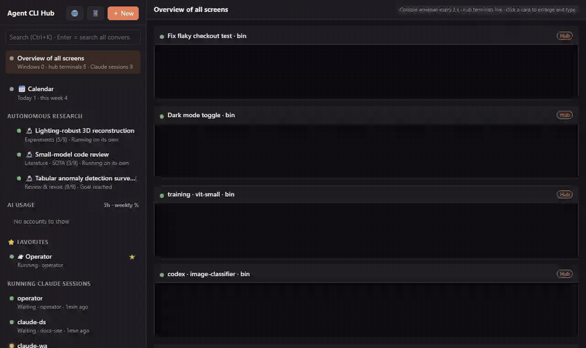

> Screenshots use a demo environment with made-up projects and conversations.

---

## Features

### 🛰 Operator session — an agent that looks after the hub
When the hub starts, it opens one **operator** session (Claude Code by default, or Codex) pinned at the top of the sidebar. Following its manual (`operator/CLAUDE.md` / `AGENTS.md`) it:
- learns the PC — GPUs, driver/CUDA, disks, network and Tailscale, proxy, tool paths, accounts — and keeps **`operator/ENVIRONMENT.md`** up to date for every other session to read;
- answers your questions about the machine and the other sessions;
- runs a periodic check (every 3 h by default, only when idle) and posts **notices** when something matters: a disk filling up, a GPU held far past its estimate, the network changing, an account near its limit.

Notices land on a board (`ccd notices`) and are typed into every running Claude/Codex hub terminal (a busy agent reads it after its turn). It never kills jobs, never switches accounts, and asks before installing or changing system settings.

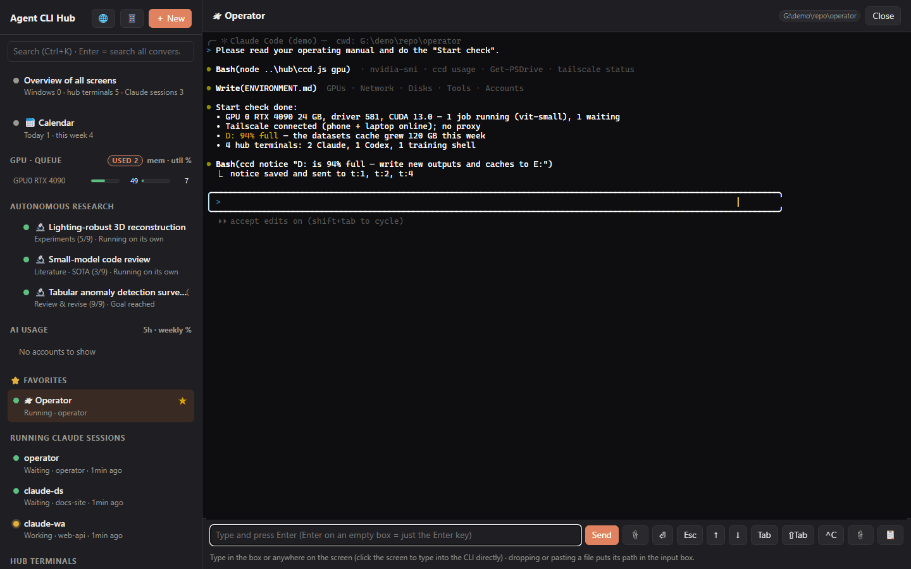

### 🖥 All screens at a glance
Every hub terminal (and, with Python, every other console window on the PC) as a live card. Click one to enlarge it and type — a real terminal (xterm.js) for hub terminals, injected keys for other windows. Drop or paste a file to insert its path.

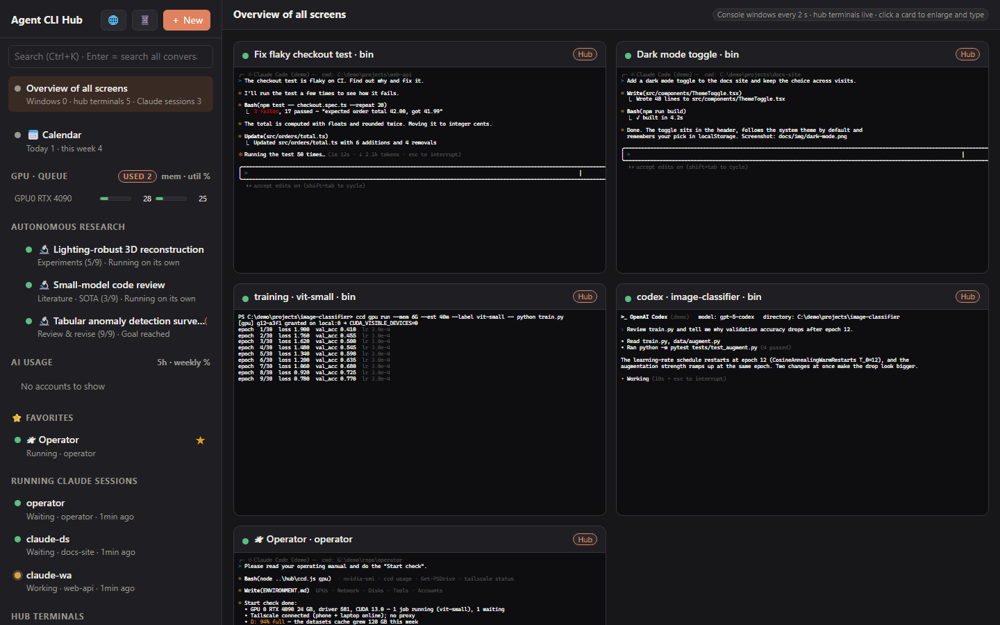

### 🤖 Claude Code, Codex, Cursor agent and shells side by side
`＋ New` opens `claude`, `codex`, `cursor-agent`, PowerShell or cmd in any folder. Codex terminals get a **Codex** badge and a live *working / idle* state read from the screen, and know which conversation they're in. Terminals live in a separate pty host, so restarting the hub server never kills them.

| Claude Code | Codex |
|---|---|
| 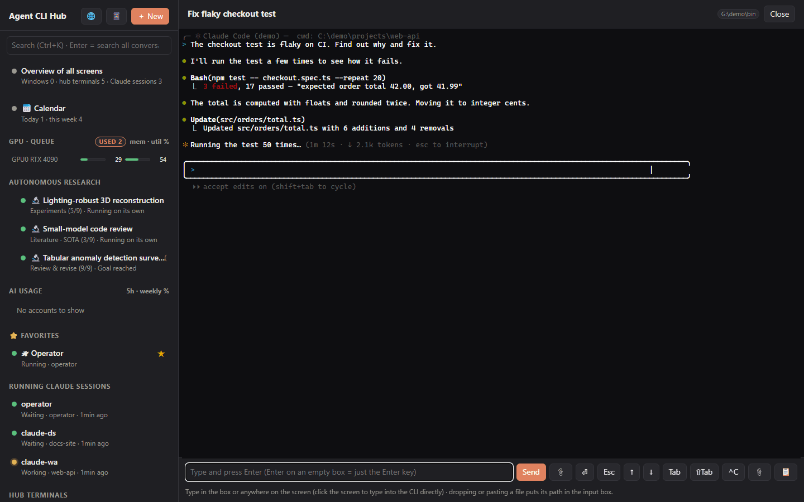 | 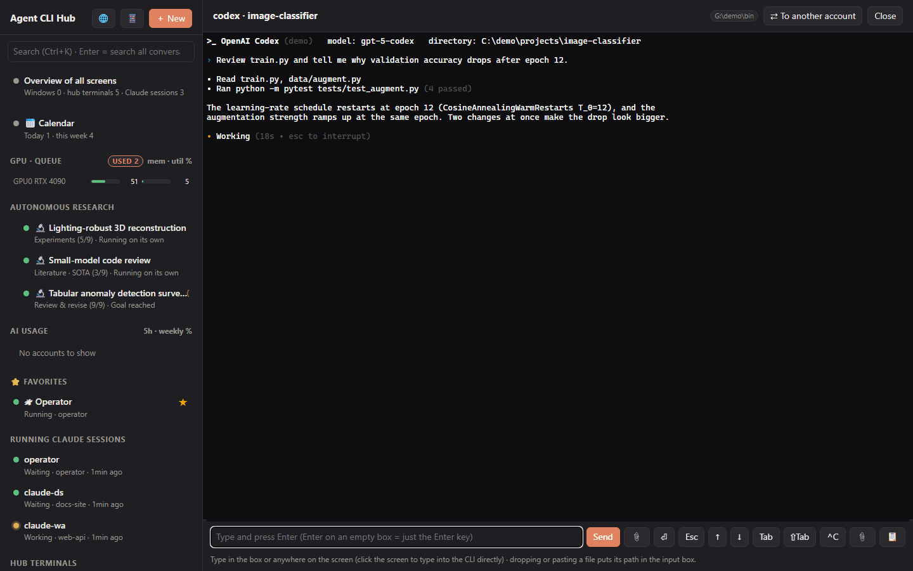 |

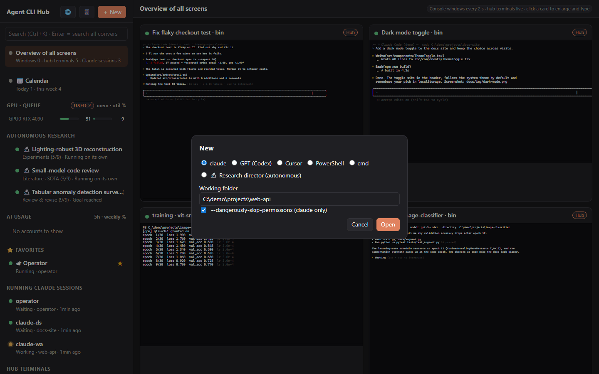

### 🔎 Search every conversation — Claude Code *and* Codex
`Ctrl+K` searches the full history of every Claude Code transcript (`~/.claude/projects`) and Codex rollout (`~/.codex/sessions`), plus the text on every open screen. Open a hit to read the conversation around it, then **continue it in the hub** — `claude --resume` or `codex resume` in the conversation's own folder.

| Search | Codex conversation |
|---|---|
| 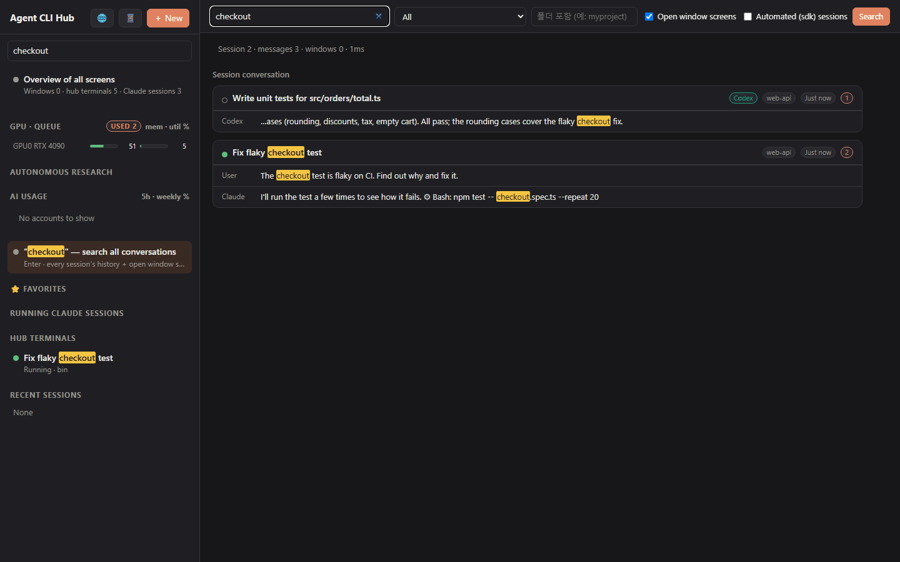 | 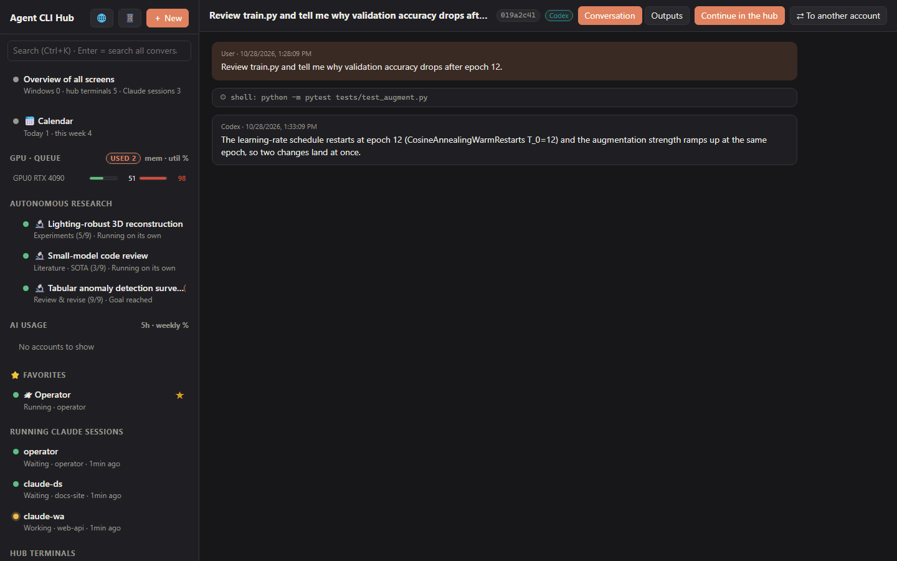 |

### 📂 Outputs — every result a session produced, previewed
Each session has an **Outputs** tab. File paths mentioned in its conversation — videos, PDFs, figures, slides, documents, data — are collected automatically, grouped by day and previewed in place: images, video and audio players, PDFs, Markdown / text / CSV, HTML in a sandbox, and PowerPoint / Word converted to PDF when LibreOffice is installed. Pin anything else with **＋ Mark an output** or `ccd artifact add <path> --title "…"`, and send a file's path back into any session with one click (↗). Autonomous research projects have the same tab. Only files listed for a session can be opened.

| Outputs tab | Preview |
|---|---|
| 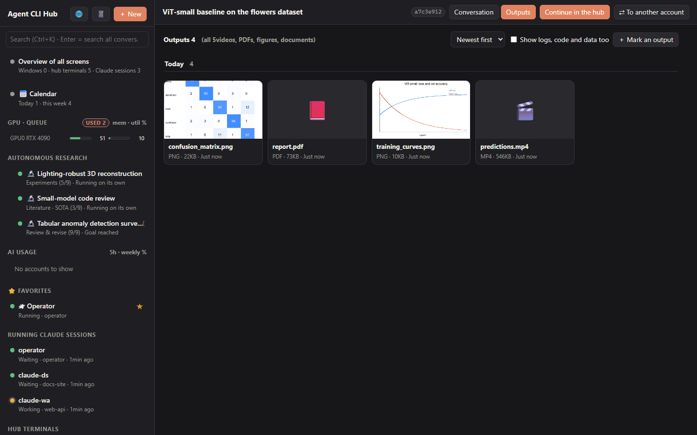 | 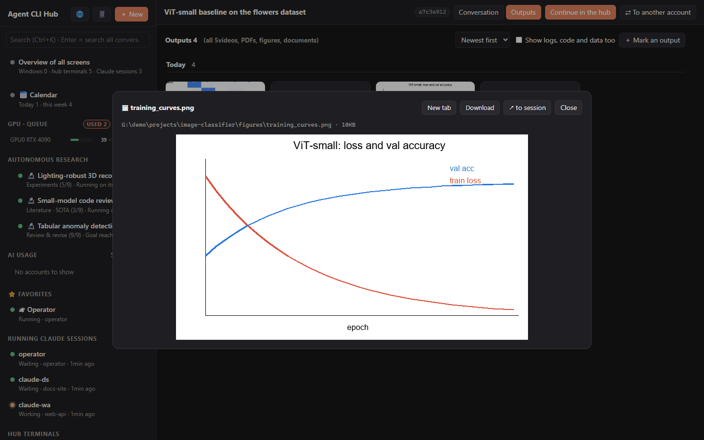 |

### 🎛 GPU queue shared by all sessions
`ccd gpu run --mem 12G --est 90m -- python train.py` waits its turn, runs with `CUDA_VISIBLE_DEVICES` set and releases the GPU when it ends. Memory and system-RAM reservations, backfilling of short jobs, heat guard, per-GPU lines, and GPU jobs started outside the queue are detected and shown as current users. Nothing outside the queue is ever killed.

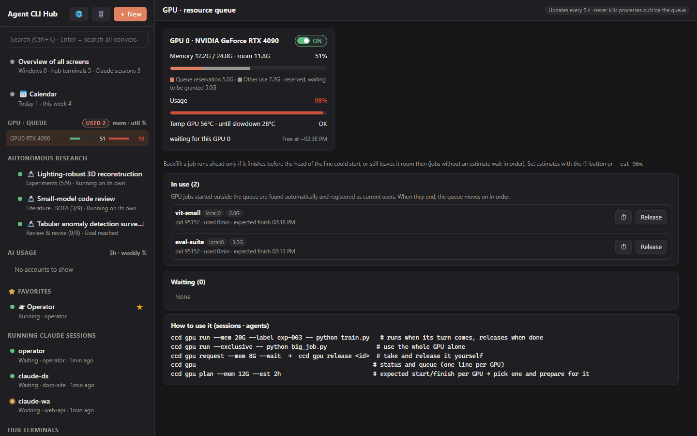

### 🔬 Autonomous research (optional)
Give a direction and a "director" Claude session runs the whole loop — ideas → venue → literature (citations checked in code) → plan → experiments (through the GPU queue) → analysis → paper → review — stopping only when it reaches the goal or gets stuck. Talk to it, pause it, branch derived studies or a synthesis paper.

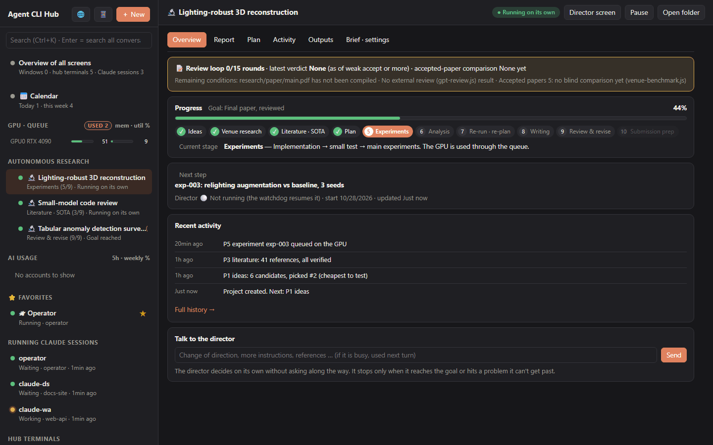

### 📅 Calendar
Deadlines from a plain `todo.md` (`- [ ] task @due(2026-11-05) #tag`) that your agents can edit too, the hub's own events, and optional Google Calendar sync (hub items go to a dedicated "Agent CLI Hub" calendar; your primary calendar's events show up in the hub).

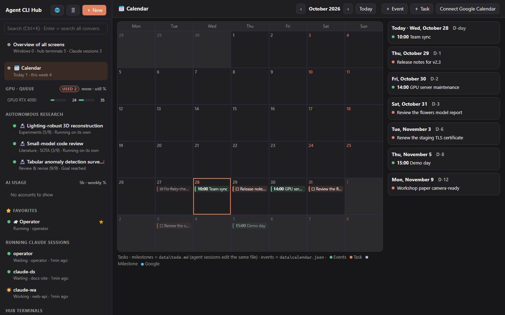

### 📱 From your phone (Tailscale)
The hub listens only on `127.0.0.1` and your Tailscale address — never the LAN. The 📱 button shows a QR code; scan it on a phone logged in to the same tailnet. The layout adapts to small screens.

| Open on another device | Phone |
|---|---|
| 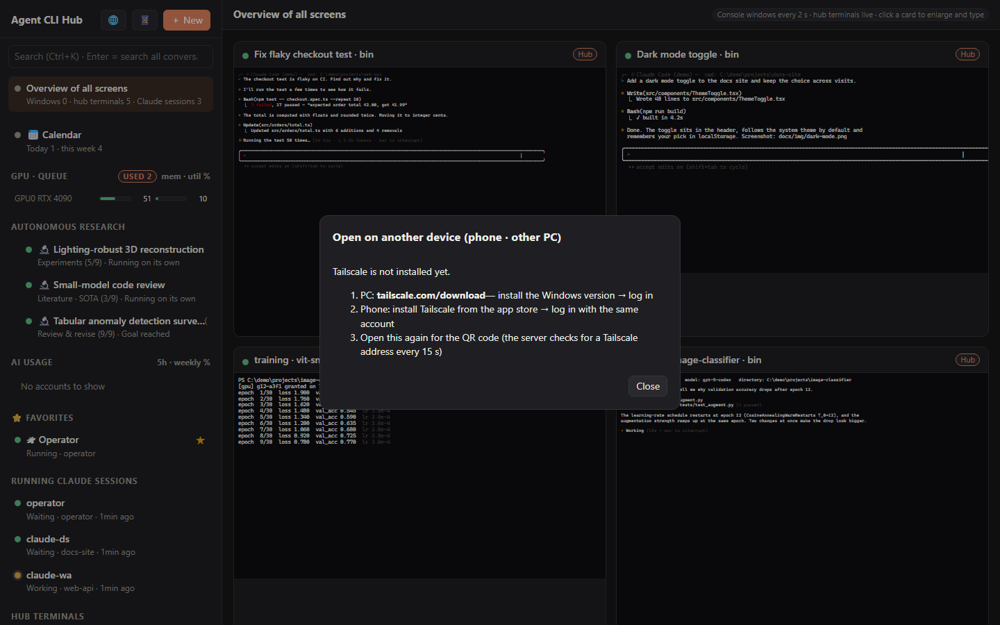 | 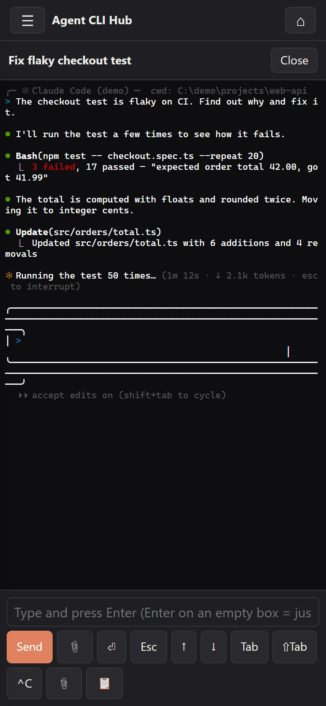 |

### 💬 Telegram relay: your sessions from Telegram (works without the hub too)
`telegram-relay/` is a separate, dependency-free bot. Make a bot with @BotFather, run `telegram-relay\setup.bat`, press START on your phone, and you can talk to any Claude Code session on this PC from Telegram. It runs the Claude CLI directly (`claude -p --resume`), so it works with or without the hub.
- 📋 Pick sessions with buttons: Recent / Open / Folders / Search tabs, ➕ new conversation.
- 📌 The chosen session stays pinned at the top of the chat.
- ⏳ A live progress card shows the steps and has a ⏹ button.
- 📱 Answers are written for a phone. Long ones page with ◀ ▶ in one message. Quick replies sit under each answer.
- 📷 Photos and files you send reach the session as paths. 📂 PDFs, figures and videos it made come back, with pictures as an album.
- 🔔 Turns you run on the PC can be forwarded too. ⚙ Permissions and model are one tap away.


Details: [telegram-relay/README.md](telegram-relay/README.md)

### 📊 AI usage and your accounts
A bundled usage dashboard (port 4777) shows Claude 5-hour / weekly limits, Codex (ChatGPT) limits, Cursor, OpenAI API costs, Gemini key status — it detects this PC's logins automatically. Add more **of your own** Codex logins with a device-code login (`＋ Add a Codex account`). A session can continue on another of your accounts with the **⇄ other account** button. Switching only ever happens when you press it.

### 🧰 Built for agents too: the `ccd` CLI
Every feature is scriptable, so your agents can coordinate each other:
```
ccd ls                                   # sessions, windows, terminals
ccd new codex --cwd C:\work\api          # open a terminal (claude | codex | cursor | powershell | cmd)
ccd send t:4 "write tests for total.ts"  # type a prompt
ccd wait t:4                             # wait until that Claude/Codex turn ends, print the screen
ccd search "flaky checkout" --agent codex
ccd log 019a2c41 --at 12                 # read a transcript around a hit
ccd gpu run --mem 8G --est 30m -- python eval.py
ccd notice "GPU 0 reserved until 18:00"  # post a notice to every session
ccd gpt "review this diff" --file d.patch   # second opinion through the Codex CLI (read-only)
```
`start.bat` installs an **`agent-cli-hub` skill** for Claude Code and adds a short guidance block to `~/.claude/CLAUDE.md` **and `~/.codex/AGENTS.md`**, so both Claude Code and Codex sessions know how to use the hub, the GPU queue and the notices.

### 🌐 English / 한국어
Switch with the 🌐 button (or `"lang"` in `hub/config.json`). Messages from the server and the CLI follow the same setting.

---

## Requirements
- Windows 10 / 11
- [Node.js](https://nodejs.org) 20 or newer (`start.bat` can install it with winget)
- At least one agent CLI: [Claude Code](https://docs.claude.com/claude-code) and/or [Codex CLI](https://github.com/openai/codex) (`npm i -g @openai/codex`), optionally Cursor's `cursor-agent`
- Optional: Python 3 (to view and type into console windows the hub didn't open), [Tailscale](https://tailscale.com) (phone / other PCs), an NVIDIA GPU (queue)

## Install
**1. Download and run.**
```
git clone https://github.com/JaekunE2/agent-cli-hub
cd agent-cli-hub
start.bat
```
No git? [Download ZIP](https://github.com/JaekunE2/agent-cli-hub/archive/refs/heads/main.zip), unzip it anywhere and double-click `start.bat`. It needs [Node.js](https://nodejs.org) 20+ — if Node.js is missing, `start.bat` offers to install the LTS version with `winget`. The first run does `npm install`. To update, `git pull` (or unzip a new ZIP over it; your settings and data are not in the download).

**2. Let your AI agent install it.** Paste this into Claude Code or Codex:
> Install Agent CLI Hub on this PC by following https://github.com/JaekunE2/agent-cli-hub/blob/main/INSTALL_FOR_AGENTS.md — ask me before anything it marks "(ask)".

**What `start.bat` does:** installs the `agent-cli-hub` skill and the guidance blocks, starts the hub (7777) and the usage dashboard (4777) without console windows, and opens the browser. The address contains an access token (also in `hub\url.txt`); on this PC `http://127.0.0.1:7777` works without it.

- Start at logon: `powershell -ExecutionPolicy Bypass -File install-autostart.ps1` (undo: `uninstall-autostart.ps1`)
- Stop: `stop.bat` (closes the hub terminals too)
- Remove the skill, guidance blocks and autostart: `uninstall.ps1`, then delete the folder

## Phone and other PCs
1. Install Tailscale on the PC and log in.
2. Install Tailscale on the phone (or the other PC) with the same account.
3. Click 📱 in the hub and scan the QR code. After the first visit the address alone works.

## Configuration — `hub\config.json` (optional; see `hub\config.example.json`)
| Key | Meaning |
|---|---|
| `lang` | `"en"` or `"ko"` (default: the Windows display language) |
| `operator` | `{ "enabled": false }` turns the operator off; `"agent": "codex"` uses Codex; `"checkEveryMin": 0` turns the periodic check off |
| `remote` | `"off"` stops listening on the Tailscale address |
| `consoles` | `false` hides other console windows (no Python needed then) |
| `codex`, `cursorAgent`, `python` | paths when they're not on PATH |
| `calendar` | `todo`, `events`, `googleAccount`, `timeZone` |
| `usageUrl`, `usageDir` | where the usage dashboard runs / keeps its accounts |

## Security
- Anyone with the token can drive the terminals on this PC. Don't share `hub\.token`, `hub\url.txt` or the QR code.
- The hub answers only on `127.0.0.1` and Tailscale (100.64.0.0/10) addresses; it refuses other origins (DNS-rebinding guard).
- Tokens and keys you add in the usage dashboard stay in `ai-usage\accounts.json` on this PC (git-ignored).
- Register only your own accounts. Using someone else's account breaks the providers' terms. The hub never rotates accounts by itself to get around usage limits.

## Repository layout
```
hub/               server, CLI (ccd.js), web UI, GPU queue, search index, i18n
ai-usage/          AI usage dashboard (port 4777)
operator/          the operator session's manual (CLAUDE.md / AGENTS.md) and ENVIRONMENT.md
research-harness/  autonomous research: hooks, project template, tools
skills/            agent-cli-hub skill + paper-review/claims/numbers/code skills
guidance/          the block start.bat puts into ~/.claude/CLAUDE.md and ~/.codex/AGENTS.md
telegram-relay/    Telegram bot for your Claude Code sessions (standalone, no dependencies)
```

## License
MIT

---

<details>
<summary><b>🇰🇷 한국어 소개 (펼치기)</b></summary>

**Agent CLI Hub**는 Windows PC에서 돌아가는 AI 코딩 에이전트(Claude Code, Codex CLI, Cursor 에이전트, 셸)를 웹 페이지 하나로 관제합니다.

- 🛰 **관제 세션**: 허브가 켜질 때 자동으로 뜨는 에이전트입니다.
  - GPU, 네트워크, 디스크, 계정 상태를 파악해 `operator/ENVIRONMENT.md`에 정리합니다.
  - 질문에 답하고, 필요할 때 다른 세션들에 공지를 보냅니다(`ccd notice`).
- 🖥 **모든 화면 모아보기**: 터미널마다 실시간 화면을 보고 바로 입력할 수 있습니다.
- 🤖 **Claude Code · Codex · Cursor · 셸**: 원하는 폴더에서 바로 띄웁니다. Codex 터미널도 작업 중/대기 상태가 보입니다.
- 🔎 **대화 전체 검색**: Claude Code와 Codex 대화 기록을 모두 검색하고, 그 대화를 원래 폴더에서 이어서 엽니다.
- 📂 **산출물 미리보기**: 세션이 만든 영상, PDF, 그림, 문서를 자동으로 모아 그 자리에서 미리 봅니다.
- 💬 **텔레그램 릴레이**: 휴대폰 텔레그램에서 버튼으로 세션을 고르고 대화합니다. 사진을 보내고, 결과 파일을 받습니다. 관제 없이도 동작합니다.
- 🎛 **GPU 대기열**: 세션들이 GPU를 순서대로 나눠 씁니다. 대기열 밖 작업은 종료하지 않습니다.
- 🔬 **자율 연구**, 📅 **캘린더**, 📊 **AI 사용량**도 들어 있습니다. 계정 전환은 사용자가 버튼을 누를 때만 일어납니다.
- 📱 **휴대폰에서 접속**: Tailscale로 접속합니다. 화면의 QR을 찍으면 됩니다.
- 🌐 한국어와 영어를 지원합니다(🌐 버튼).

**설치:** `git clone https://github.com/JaekunE2/agent-cli-hub` 후 `start.bat`을 실행하세요. 또는 에이전트에게 "https://github.com/JaekunE2/agent-cli-hub/blob/main/INSTALL_FOR_AGENTS.md 를 따라 설치해줘"라고 맡기면 됩니다.
자세한 내용은 **[한국어 README](README.ko.md)**에 있습니다.

</details>
