# Agent CLI Hub

**One unified control center for every AI coding agent on your Windows PC** — Antigravity CLI (AGY), Claude Code, OpenAI Codex CLI, Cursor Agent, and PowerShell/cmd shells in one fast web workspace. Plan projects with AI, track hierarchical token usage across CLIs, inspect codebase architecture interactively, share GPUs safely, and manage sessions from desktop or phone over Tailscale.

**English** · [한국어](README.ko.md)

<sub>Install: `git clone https://github.com/JaekunE2/agent-cli-hub` and run `start.bat` — or ask your AI agent to install it (see [Install](#install)).</sub>

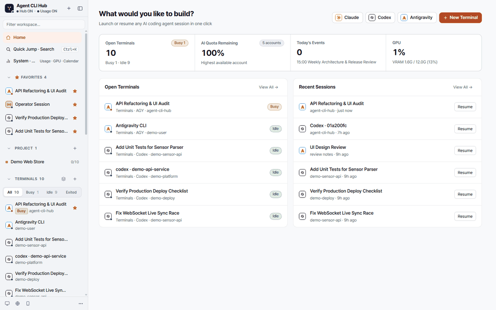

> Note: Existing gallery screenshots below were captured on an earlier demo environment; this branch (`dev_side`) introduces the redesigned Crisp Minimal UI (light/dark themes, unified `Hub Core` icon, hairline stat strips, Project Kanban/DAG workflow, Antigravity CLI support, and interactive Floorplan architecture mapping).

---

## Highlights & Design System

- **Crisp Minimal UI (Light & Dark Themes):** Built around `Astryx` control consistency, `impeccable` anti-slop/WCAG AA hygiene, and hairline-first elevation — clean sidebar/canvas surface separation, a unified 4-column hairline overview bar, flattened border-first cards without visual clutter, and `≥ 24×24px` touch targets.
- **Unified `Hub Core` Identity & Live Health LED:** One consistent **Hub Core** symbol across the web brand button, dynamic status favicon, `icon.svg`, and Windows System Tray (`tray.ps1`). Click the top-left brand header to open the **Server & Integration Status Popover** (`:7777` Hub, PTY Host, `:4777` Usage Server, AGY Quota) and start services in one click.
- **Sticky Workspace Tabs & Smart Cache-Busting:** Terminal and transcript views remember your last selected tab (`Screen`, `Screen + Chat`, `Transcript`, `Outputs`, `Floorplan`). Server restarts automatically refresh non-typing views via `SERVER_BUILD_ID` without interrupting active terminal input.

---

## Features

### 🗂 Project Workspaces — Design · Kanban · DAG Flow · Sub-Dev Chat · Tokens
Organize multi-step coding work under **Project** in the Linear-style sidebar:
- **AI Plan Generation (`작업 설계`):** Choose a workspace folder (host browser or Windows Explorer picker), define goals and acceptance criteria, and auto-generate structured tasks (`plan`, `dev`, `test`, `ops` kinds) with per-CLI **model & reasoning effort** settings for **AGY**, **Claude Code**, and **Codex CLI**.
- **Kanban & Draggable DAG Workflow (`칸반 보드` / `작업 흐름`):** Move tasks across `Planned → Doing → Review → Done` or visualize dependency chains on an auto-arranged Sugiyama DAG canvas with transitive edge reduction, free node drag-and-drop, zoom/fit controls, and dependency chain highlighting.
- **Subtasks & Embedded Sub-Development Chat:** Split parent tasks into child subtasks and chat directly inside a task's Detail Drawer (`서브 개발`).
- **Cumulative Multi-CLI Token Ledger:** Tracks input/output/cache tokens per session and CLI in `hub/data/projects.json`, preserving history when switching agents and rolling up every descendant subtask's tokens into top-level parent badges and the Project Token Drawer.

### 🗺 Floorplan — Interactive Code Architecture Map & Report (`코드 구조`)
Available inside every **Project**, **Terminal**, **External Console**, and **Transcript** tab:
- **Ranked Core Hub Summary (`핵심 요약 · 모듈 목록`):** Zero-dependency static scanner ([`hub/workspace-floorplan.js`](hub/workspace-floorplan.js)) respects `.gitignore`, scans JS/TS/Python/Go files, ranks true architectural hubs by incoming references & API endpoints, and opens a File Detail Drawer on click.
- **Interactive Core Hub Architecture Map (`시스템 계층도`):** Displays curated core hubs per architectural layer (`UI → API → Core Logic → Data`) with subtle Bezier connections and **hover/click Blast Radius isolation** (highlighting incoming callers in green and outgoing dependencies in accent orange), search filter, pan, and zoom/fit.
- **Security & Structure Audit (`보안 · 구조 점검`):** Flags exposed secrets, unguarded routes, `.env` gitignore gaps, and oversized modules with 1-click task creation or terminal fix-prompt injection.
- **Deliverable Export & Artifact Pinning:** Preview formatted Markdown architecture reports (`보고서 보기`, including an auto-generated Mermaid diagram and Top 15 Core Hubs table), copy, download `.md`, or save **`FLOORPLAN.md`** directly into the project folder and pin it to the session's **Outputs** tab. Also supports scanning arbitrary local directories (`폴더 선택`) and shows a **Design Blueprint** view for empty folders.

### 🤖 Antigravity CLI (AGY), Claude Code, Codex CLI, Cursor & Shells
- **Full AGY Support:** Discovers transcripts across `~/.gemini/antigravity/brain`, `antigravity-cli/brain`, and `antigravity-ide/brain`, detects live `busy / idle` screen state, monitors per-tier 5h/weekly AGY quotas, and resumes sessions seamlessly.
- **Smart Clipboard Paste (`Ctrl+V` / `Ctrl+Shift+V`):** Inside a terminal screen on Windows, pressing `Ctrl+V` with text pastes directly into the prompt via `xterm.js`, while `Ctrl+V` with an image forwards raw `^V` (`0x16`) straight to the CLI so native TUI image attachment keeps working. Use `Ctrl+Shift+V`, drag-and-drop, or remote paste to upload files to `hub/uploads/` and insert quoted paths.
- **Persistent PTY Host:** Terminals run inside a separate `ptyhost.js` daemon, surviving hub server restarts.
- **Session Deduplication:** Prevents duplicate active terminals when resuming, recovering, or switching accounts.

### 🛰 Operator Session — an agent that looks after the hub
When the hub starts, an optional **operator** session (Claude Code by default, or Codex) stays pinned at the top of the sidebar. Following `operator/CLAUDE.md` / `AGENTS.md`, it documents hardware/network state in **`operator/ENVIRONMENT.md`**, answers environment questions, and posts idle-time health **notices** (`ccd notices`) for disk space, long-running GPU jobs, or low quotas without ever killing user jobs or switching accounts automatically.

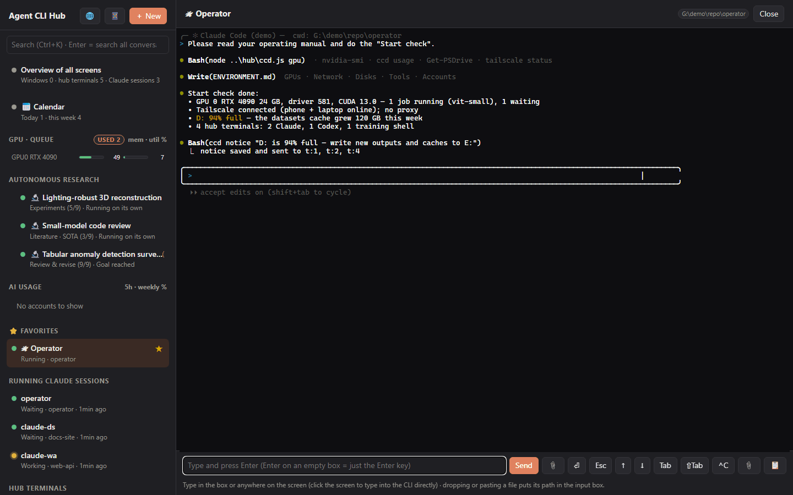

### 🖥 All Screens at a Glance & Split Terminal View
View every hub terminal (and optionally external PC console windows via Python) as live cards. Click any terminal to open full `Screen`, `Screen + Chat` split view with resizable divider, `Transcript` with inline prompt composer, `Outputs`, or `Floorplan`.

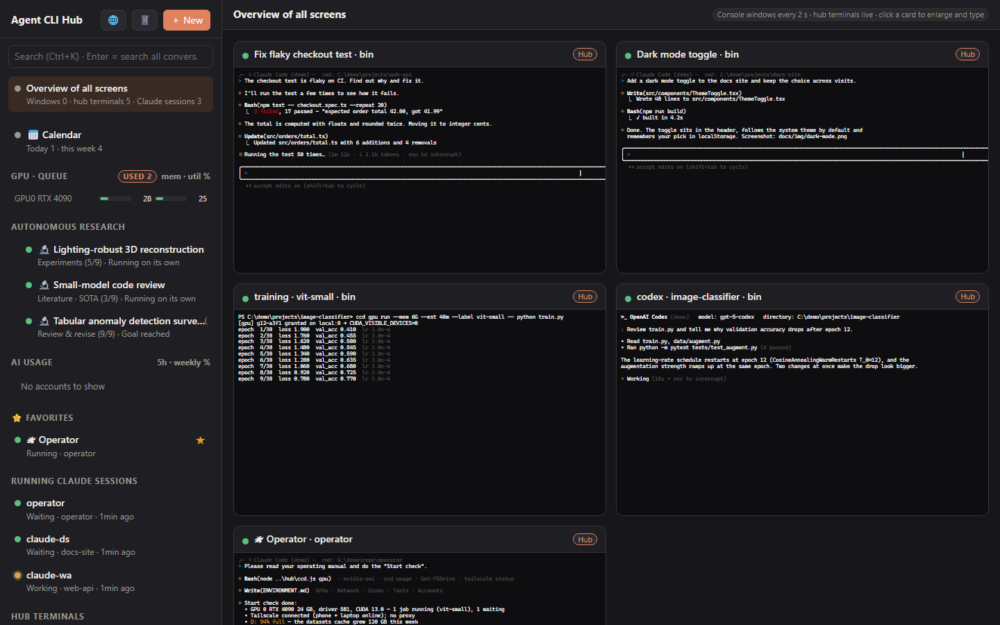

| Claude Code | Codex |
|---|---|
| 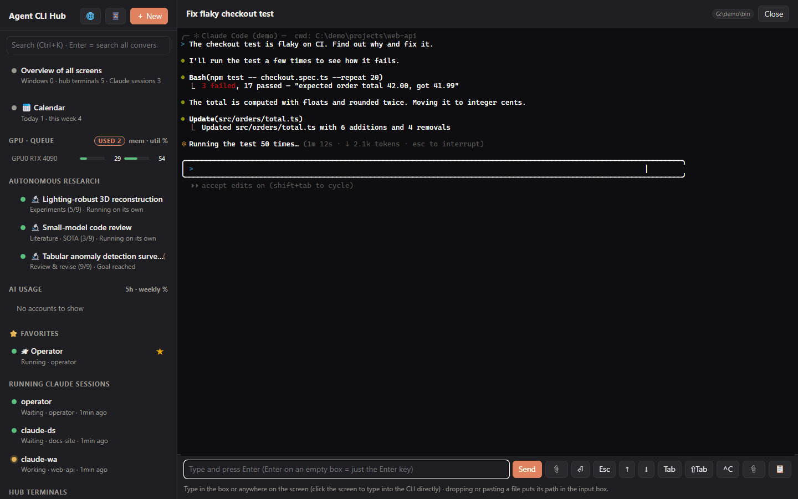 | 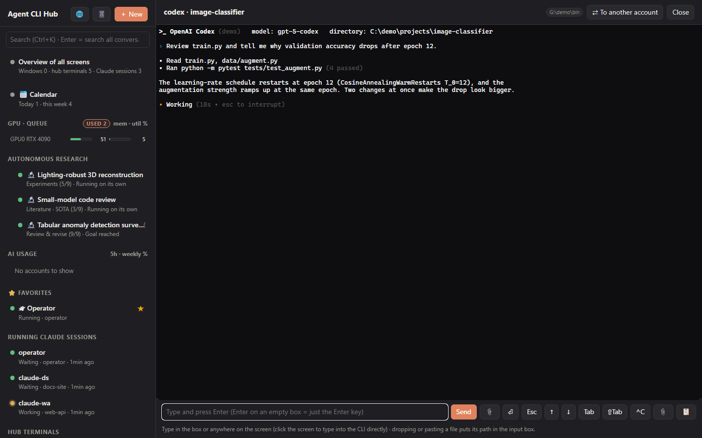 |

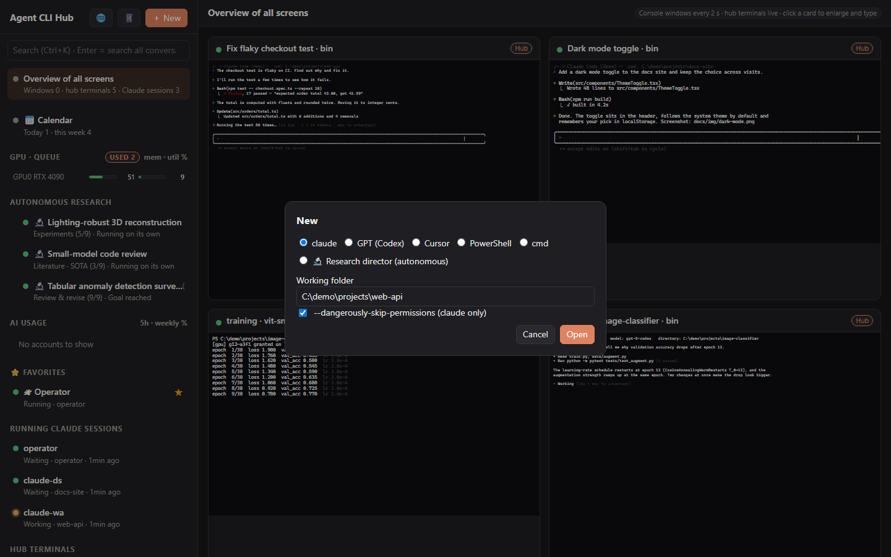

### 🔎 Search Every Conversation — AGY, Claude Code *and* Codex
`Ctrl+K` (or the sidebar search page) searches full conversation histories across **AGY**, **Claude Code** (`~/.claude/projects`), and **Codex** (`~/.codex/sessions`) plus live open screens. Open any hit to inspect context and continue it directly in the hub (`--resume`).

| Search | Codex conversation |
|---|---|
| 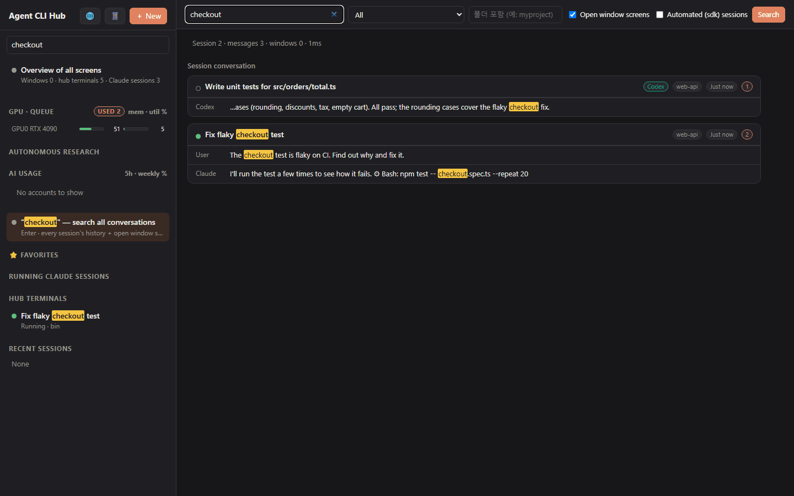 | 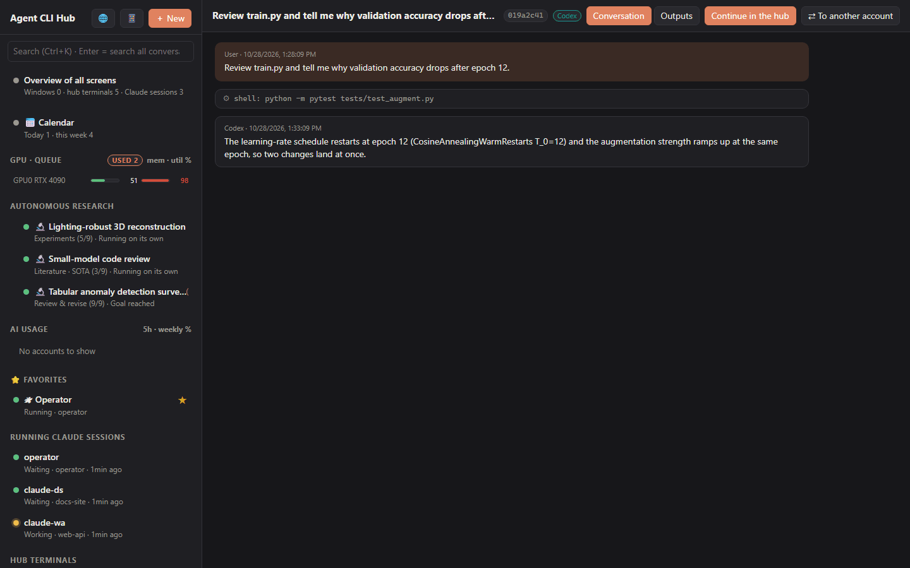 |

### 📂 Outputs — Every Result Previewed in Place
Each session collects produced files (videos, PDFs, images, Markdown, CSV, sandboxed HTML, LibreOffice-converted slides/docs) by date inside the **Outputs** tab. Pin custom files with **＋ Mark an output** (`ccd artifact add`) or save `FLOORPLAN.md` directly from Code Architecture.

| Outputs tab | Preview |
|---|---|
| 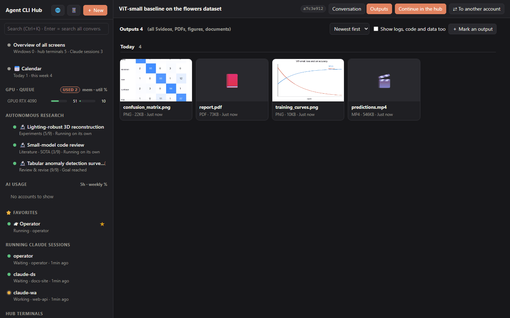 | 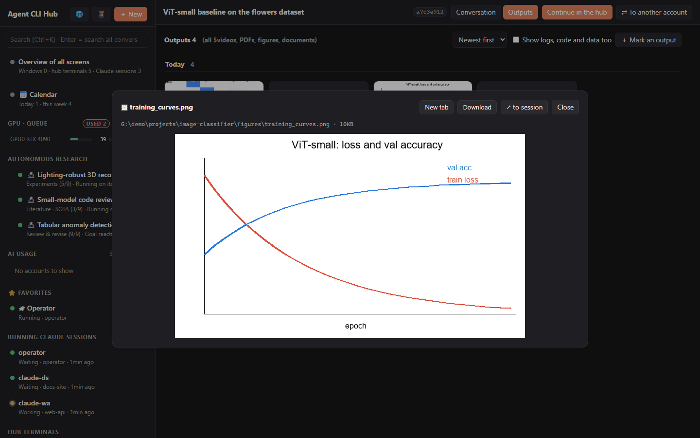 |

### 🎛 GPU Queue Shared by All Sessions
`ccd gpu run --mem 12G --est 90m -- python train.py` waits cleanly, sets `CUDA_VISIBLE_DEVICES`, reserves memory/system RAM, supports short-job backfilling and heat guards, and surfaces non-queue external GPU jobs without ever terminating them.

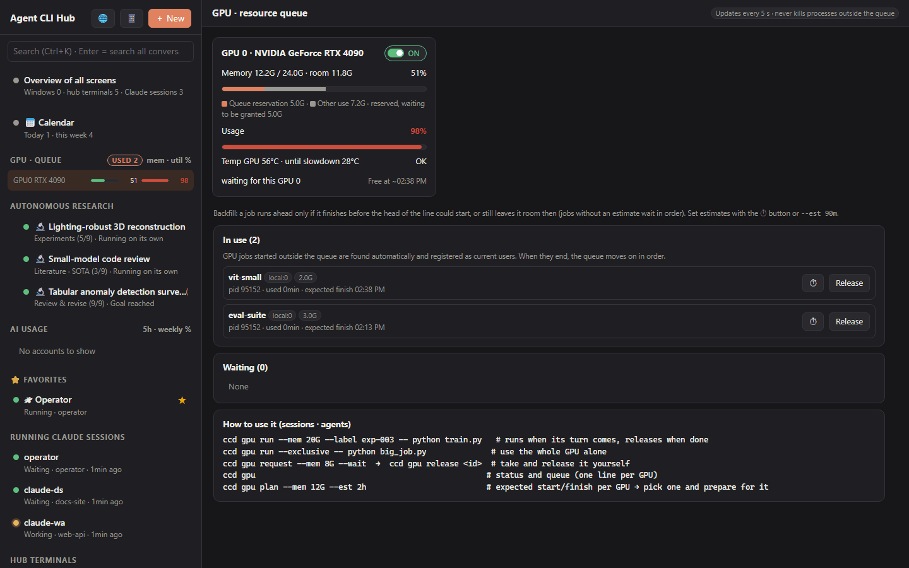

### 🔬 Autonomous Research (Optional)
Run structured multi-phase research loops (`ideas → venue → literature → plan → experiments → analysis → paper → review`) powered by `research-harness/` and the GPU queue.

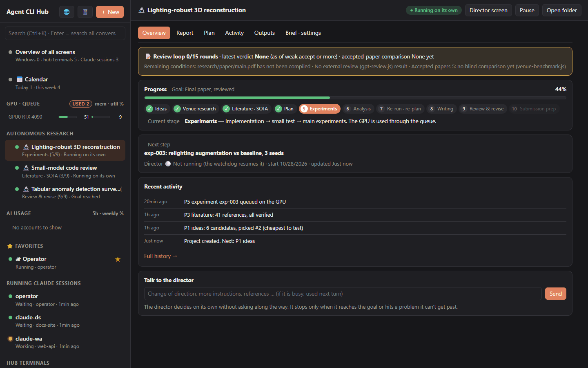

### 📅 Calendar & Task Deadlines
Combines `todo.md` due dates (`- [ ] task @due(2026-11-05) #tag`), hub events, and optional Google Calendar / Teams sync in a unified month + agenda view.

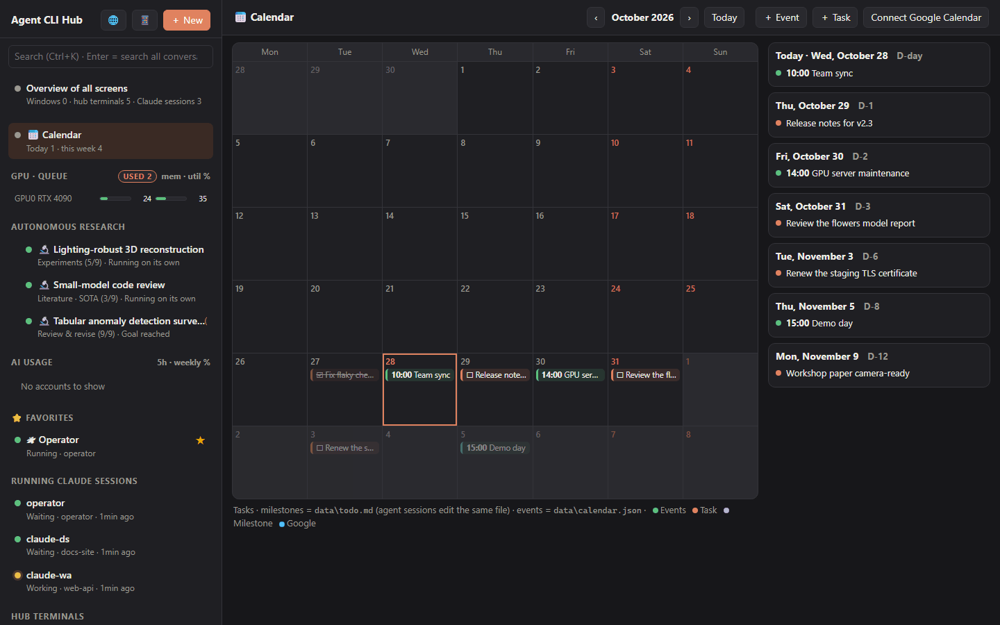

### 📱 Phone & Remote Access (Tailscale) + 💬 Telegram Relay
The hub binds only `127.0.0.1` and your Tailscale IP (never public LAN). Scan the 📱 QR code from another device on your tailnet. For Telegram control without opening the dashboard, see **[JaekunE2/claude-telegram-relay](https://github.com/JaekunE2/claude-telegram-relay)**.

| Open on another device | Phone |
|---|---|
| 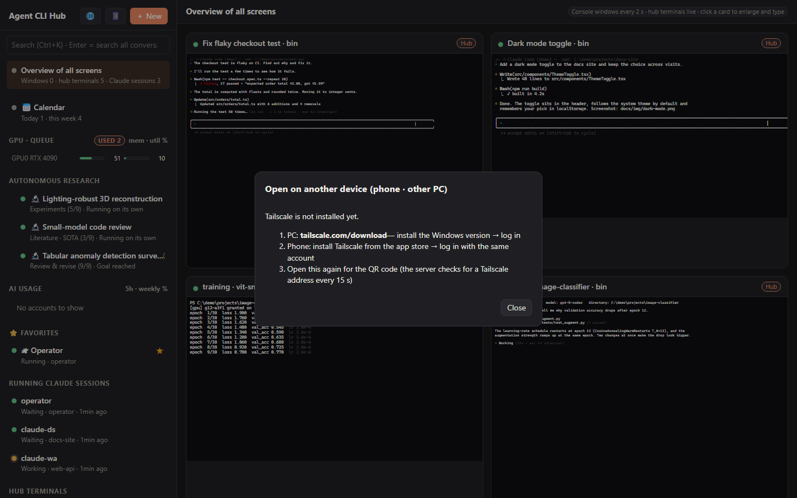 | 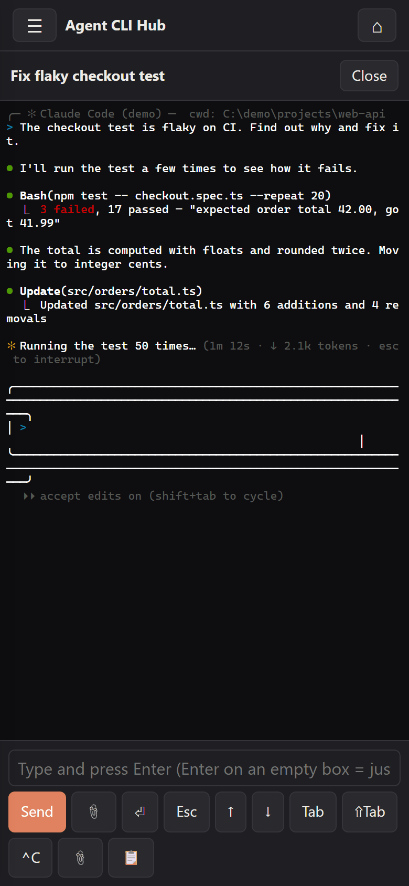 |

### 📊 AI Usage & Account Switching
The bundled usage dashboard (port `4777`) tracks Claude 5h/weekly limits, Codex (ChatGPT) quotas, **AGY per-tier quotas**, Cursor, OpenAI API spend, and Gemini keys. Add additional Codex logins via device-code auth and switch accounts intentionally via **⇄ Switch Account**.

### 🧰 Built for Agents Too: the `ccd` CLI
```bash
ccd ls                                   # sessions, windows, terminals
ccd new codex --cwd C:\work\api          # open a terminal (claude | codex | agy | cursor | powershell | cmd)
ccd send t:4 "write tests for total.ts"  # send a prompt
ccd wait t:4                             # wait for turn completion, print screen
ccd search "flaky checkout" --agent codex
ccd log 019a2c41 --at 12                 # inspect transcript around a hit
ccd gpu run --mem 8G --est 30m -- python eval.py
ccd notice "GPU 0 reserved until 18:00"  # broadcast notice to active terminals
ccd gpt "review this diff" --file d.patch
ccd restart                              # safely restart hub server (keeps PTY terminals alive)
```

### 🌐 English / 한국어
Switch anytime with the bottom-left 🌐 button (or `"lang"` in `hub/config.json`).

---

## Requirements
- Windows 10 / 11
- [Node.js](https://nodejs.org) 20 or newer
- At least one agent CLI: [Claude Code](https://docs.claude.com/claude-code), [Codex CLI](https://github.com/openai/codex), Antigravity CLI (`agy`), or Cursor `cursor-agent`
- Optional: Python 3 (external console capture), [Tailscale](https://tailscale.com) (mobile/remote access), NVIDIA GPU (`nvidia-smi` for GPU queue)

## Install & Run

**Option 1: One-click Windows launcher**
```powershell
git clone https://github.com/JaekunE2/agent-cli-hub
cd agent-cli-hub
start.bat
```

**Option 2: Direct Node.js install & commands**
```powershell
cd hub
npm install
npm start
```
To run the automated test suite:
```powershell
cd hub
npm test
```

`start.bat` installs the `agent-cli-hub` skill and guidance blocks, launches the Hub (`http://127.0.0.1:7777`), AI Usage server (`http://127.0.0.1:4777`), and Windows System Tray monitor (`tray.ps1`) without console windows.
- Autostart at logon: `powershell -ExecutionPolicy Bypass -File install-autostart.ps1` (undo: `uninstall-autostart.ps1`)
- Stop all services: `stop.bat`
- Uninstall integration: `uninstall.ps1`

## Configuration — `hub\config.json` (optional; see `hub\config.example.json`)
| Key | Meaning |
|---|---|
| `lang` | `"en"` or `"ko"` (default: Windows display language) |
| `operator` | `{ "enabled": false }` disables operator; `"agent": "codex"` uses Codex; `"checkEveryMin": 0` disables periodic check |
| `remote` | `"off"` disables listening on Tailscale IP |
| `consoles` | `false` hides non-hub console windows (no Python needed) |
| `codex`, `cursorAgent`, `python` | explicit executable paths when not on `PATH` |
| `calendar` | `todo`, `events`, `googleAccount`, `timeZone` |
| `usageUrl`, `usageDir` | usage dashboard URL / data folder |

## Security
- Anyone holding the hub token can control terminals on this PC — keep `hub\.token`, `hub\url.txt`, and QR links private.
- Binds strictly to `127.0.0.1` and Tailscale CGNAT (`100.64.0.0/10`) with origin / DNS-rebinding checks.
- Usage tokens stay locally in `ai-usage\accounts.json` (git-ignored). Account switching happens only when explicitly triggered by the user.

## Repository Layout
```text
hub/               server, CLI (ccd.js), web UI, Project & Floorplan engines, GPU queue, search index, i18n, tests
ai-usage/          AI usage & quota server (port 4777)
operator/          operator session instructions & ENVIRONMENT.md
research-harness/  autonomous research hooks, templates, tools
skills/            agent-cli-hub skill + research/review skills
guidance/          CLI prompt blocks installed into ~/.claude/CLAUDE.md and ~/.codex/AGENTS.md
.claude/           impeccable web design critique, audit & anti-pattern detection skills
tray.ps1           Windows system tray monitor (Hub Core status icon)
```

## License
MIT

---

<details>
<summary><b>🇰🇷 한국어 소개 (요약 펼치기)</b></summary>

**Agent CLI Hub**는 Windows PC의 AI 코딩 에이전트(**Antigravity CLI · Claude Code · Codex CLI · Cursor · 셸**)를 웹 대시보드 하나로 통합 관제합니다.

- 🎨 **Crisp Minimal UI & 통합 Hub Core 아이콘**: 라이트/다크 3단 표면 분리, 4열 헤어라인 지표 바, 제로 섀도우 정돈된 카드 위계, 웹·파비콘·Windows 트레이(`tray.ps1`)가 동일한 **Hub Core** 심볼과 실시간 상태 팝오버로 연동됩니다.
- 🗂 **Project 작업 설계 · 칸반 · 작업 흐름(DAG) · 서브 개발 · 토큰 합산**: 목표 기반 AI 태스크 분해, 모델/추론 강도 선택, 드래그 가능한 DAG 의존성 맵, 태스크 내장 서브 개발 채팅, 하위 태스크 누적 토큰의 최상위 롤업 집계를 제공합니다.
- 🗺 **코드 구조(Floorplan) & 보고서 산출물**: 임의 폴더 정적 분석, 핵심 허브 랭킹, **인터랙티브 계층 맵(Blast Radius 연결 강조)**, 보안/구조 점검, Mermaid 포함 마크다운 보고서 미리보기 및 `FLOORPLAN.md` 산출물 자동 핀 저장을 지원합니다.
- 🤖 **AGY · Claude · Codex 통합 & 스마트 `Ctrl+V`**: AGY 대화/쿼터 연동, 터미널·최근 대화 마지막 탭 기억, 터미널 내 텍스트 `Ctrl+V` 붙여넣기 및 로컬 이미지 `^V` 네이티브 붙여넣기를 모두 지원합니다.

자세한 내용은 **[한국어 README](README.ko.md)**를 참고하세요.

</details>
